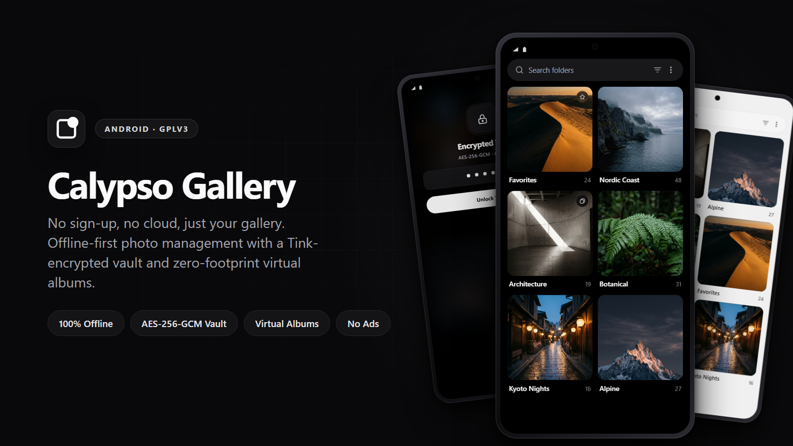

<p align="center">
  
</p>

# Calypso Gallery

A private, offline-first gallery with an encrypted vault and zero-footprint virtual albums.

## Why this fork

Calypso Gallery is an independently maintained fork of [Fossify Gallery](https://github.com/FossifyOrg/Gallery), based on upstream commit [`268836024`](https://github.com/FossifyOrg/Gallery/commit/2688360242468f1d591eddf23740c879616bb828) (`v1.14.2`, 07-11-2026). It keeps the familiar gallery experience while replacing the parts that matter for private, local-only use: network access is removed, media can be stored in a cryptographic vault, and albums can reference files without copying them.

The upstream project and its contributors retain their copyright in the inherited code. This is an unofficial fork and is not affiliated with, endorsed by, or supported by the Fossify organization. Version `1.0.0` is the first public release; it does not map one-to-one to any upstream version. Fork changes are recorded in [FORK_CHANGELOG.md](FORK_CHANGELOG.md), while [CHANGELOG.md](CHANGELOG.md) preserves the upstream-only release history.

## Highlights

- **Encrypted vault** — Tink streaming AEAD with Argon2id key derivation, biometric unlock, password changes, export/import and archive recovery.
- **Zero-footprint virtual albums** — group media by reference; no duplicate files and no extra storage. Albums backed by vault items stay hidden and encrypted.
- **Offline by design** — the `INTERNET` and `ACCESS_NETWORK_STATE` permissions are removed from the merged manifest. No cloud, no telemetry, no ads.
- **Resumable file operations** — copy, move, encrypt, decrypt and delete run as one tracked foreground operation with progress, staging, atomic replacement and recovery after interruption.
- **Smart conflict handling** — byte-by-byte comparison with side-by-side previews, plus automatic deduplication and album merge modes.
- **Local password strength** — an on-device estimator guides vault password creation; nothing is uploaded or sent anywhere.
- **Tablet-ready layouts** — responsive grids, large-screen dialogs and landscape corrections across the app.
- **Desktop tooling** — a companion CLI for encrypting media and syncing an external vault, including Tails OS usage.

## How it differs from Fossify Gallery

| Area | Calypso Gallery |
| --- | --- |
| Network | Network permissions removed; the app runs offline only |
| Storage | Vault data under `Secrets`; automatic favorites and album backups in app storage |
| Albums | Stable file identity survives folder renames and moves; hidden/public vault isolation |
| Security | Tink AEAD vault, Argon2id KDF, `FLAG_SECURE`, RAM zeroization, clipboard and overlay leak hardening |
| Appearance | Local appearance screen with light, dark and custom palettes; settings search |
| Biometrics | Class 3 / `BIOMETRIC_STRONG` only, tied to hardware-backed keystore keys |
| Upstream prompts | Donation, rating, "Thank You" and modded-app checks removed |

## Quick start

Requires Android 8.0 (API 26) or newer. Build the FOSS variant with:

```sh
./gradlew assembleFossRelease
```

Release builds use the application ID `com.calypso.gallery`; the Kotlin namespace stays `org.fossify.gallery` for compatibility with inherited sources. Debug builds use `com.calypso.gallery.debug`. See [tools/calypso-cli/README.md](tools/calypso-cli/README.md) for the desktop CLI.

## Documentation

- [DOCS.md](DOCS.md) — architecture, cryptography, vault design and user guide
- [FORK_CHANGELOG.md](FORK_CHANGELOG.md) — fork changes, grouped by release
- [CHANGELOG.md](CHANGELOG.md) — upstream Fossify Gallery release history
- [docs/adr](docs/adr) — architecture decision records
- [tools/calypso-cli/README.md](tools/calypso-cli/README.md) — command-line vault tooling

## License and attribution

Calypso Gallery is free software licensed under the **GNU General Public License, version 3**. The full text is in [LICENSE](LICENSE) and bundled in the app under **About → Read the GNU GPL v3 license**. The complete corresponding source for every release is available in this repository and in the source archives attached to each release.

The upstream Fossify Gallery source remains available at [FossifyOrg/Gallery](https://github.com/FossifyOrg/Gallery). Bundled third-party components include Tink Java (Apache-2.0), RustCrypto Argon2 / zeroize / jni (Apache-2.0 or MIT) and Material Design Icons (Apache-2.0); the complete in-app list is under **About → Third-party licenses**, and the raw Tink attribution is in [app/src/main/res/raw/tink_license.txt](app/src/main/res/raw/tink_license.txt).
