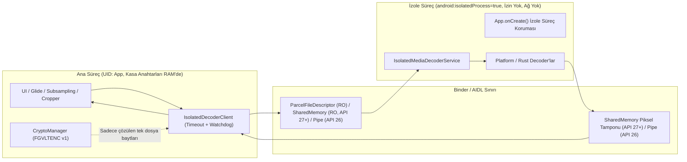

# ADR 0009: İzole Medya Çözme Mimarisi (`android:isolatedProcess="true"`)

- **Durum:** Tamamlandı (Faz 0–4 uygulandı)
- **Tarih:** 2026-11-27
- **Hedef:** Güvenilmeyen veya üçüncü parti C/C++ yerel (native) decoder kullanan medya formatlarını ana uygulama sürecinden tamamen izole etmek ve ilerleyen fazlarda izole süreç içi bellek-güvenli Rust decoder katmanı ile derinlemesine savunma sağlamak.

---

## 1. Bağlam ve Tehdit Modeli

Calypso Gallery, kasa (vault) anahtarlarını ve çözülmüş kullanıcı oturum verilerini ana uygulama sürecinin RAM'inde tutar. Uygulama aşağıdaki C/C++ JNI ve platform medya çözücülerine bağımlıdır:

- **GIF:** `pl.droidsonroids.gif:android-gif-drawable` (`giflib` — C + JNI)
- **WebP:** `com.github.zjupure:webpdecoder` (`libwebp` — C/C++ + JNI; `CVE-2023-4863` nedeniyle sistem decoder yerine kullanılıyor)
- **AVIF:** Android 12+ (`API 31+`) cihazlarda izole süreç içindeki platform `ImageDecoder` (`dav1d` / Mainline); gömülü `glide:avif-integration` (`libavif`/`libaom`) C++ bağımlılığı kaldırılmıştır (Android 8–11 için gelecekte `rav1d` değerlendirmesi `TODO.md` içinde takip edilir)
- **JPEG XL:** `io.github.awxkee:jxl-coder-glide` (Rust + C/C++ `libjxl` NDK; Faz 4'te saf Rust `jxl-oxide`'a geçeceği için destek korunur)
- **JPG / PNG / HEIC / RAW:** Android `BitmapFactory` / `ImageDecoder` / `BitmapRegionDecoder` (Skia / `libjpeg-turbo` / DNG codec'leri)
- **SVG:** `com.caverock:androidsvg-aar` (Saf Java; RCE riski düşük olsa da hatalı SVG'lerde OOM / CPU DoS riski taşır)

Bu decoder'ların tamamını bellek güvenli bir dile (ör. Rust) taşımak tek başına yeterli değildir ve ciddi ödünleşimler doğurur:
- **Platform özelliklerinin kaybı:** JPEG/PNG tarafında yalnızca Rust crate'leri kullanmak; ICC / geniş renk gamutu, HDR / Ultra HDR gain map, progressive/CMYK/bozuk dosya toleransı gibi olgun platform özelliklerini kaybetmeye yol açar.
- **OS yama gecikmesi (`minSdk = 26`):** `Skia`, `libjpeg-turbo` ve `libpng` yoğun fuzzing görse de yamalar kullanıcılara yalnızca OEM/OS güvenlik güncellemeleriyle ulaşır; güncelleme almayan Android 8–12 cihazlarda eski açıklar yıllarca kalabilir.
- **Rust'ın çözemediği riskler:** Decompression bomb, aşırı bellek tüketimi, sonsuz döngü ve FFI sınırında yakalanmayan `panic` çökmeleri Rust'ta da mümkündür.

Buna karşılık **yetki ayrımı (privilege separation)** yaklaşımıyla tüm medya çözümlemesini `android:isolatedProcess="true"` işaretli ayrı bir servise taşımak:

1. Decoder içinde bir RCE / heap overflow / UAF açığı tetiklense bile saldırganı **`isolated_app` SELinux sandbox'ı** ve çekirdek **`seccomp-bpf`** filtresi içinde hapseder (uygulama UID'si yok, dosya sistemi erişimi yok, ağ erişimi yok, sistem servislerine erişim yok).
2. `minSdk = 26` (Android 8.0) korunur; `isolatedProcess="true"`, `isolated_app` SELinux ve `seccomp-bpf` API 26'dan beri aktiftir (`android:useAppZygote="true"` ise Bölüm 5'teki nedenlerle bilinçli olarak kullanılmamıştır).
3. Saldırganın ana süreç RAM'indeki kasa anahtarlarına (`CryptoManager`) veya diskteki diğer dosyalara ulaşmasını engeller.
4. OOM, sonsuz döngü (DoS) veya `SIGSEGV` çökmelerinde yalnızca izole servisin kapanmasını sağlar; ana uygulama ayakta kalır.
5. Faz 4'te izole sürecin *içindeki* yüksek riskli C/C++ decoder'ların (`giflib`, `libwebp`, `libjxl`, `png`/`jpeg`) saf Rust crate'lerle (`rust/calypso-media/`) değiştirilmesini kolaylaştırır.

---

## 2. Kapsam ve Ana Süreç Decode Envanteri

### İzole Edilecek Katmanlar
- **Statik raster görseller:** `JPG`, `JPEG`, `PNG`, `WebP`, `AVIF`, `JXL`, `HEIC`, `RAW/DNG`, `APNG` (ilk kare)
- **Animasyonlu görseller:** Yalnızca `GIF` (tam ekran); `aWebP`, `APNG`, `aAVIF` statik ilk kareye düşürülür
- **Vektör görseller:** `SVG` (OOM ve CPU DoS izolasyonu için)
- **Boyut/sınır okuma, küçük resim ve bölgesel çözme:**
  - `CryptoManagerFileCrypto` içindeki kasa şifreleme sırasında üretilen gömülü küçük resimler (`BitmapFactory`)
  - Glide ve KSP tarafından ana süreçte otomatik bağlanan `LibraryGlideModule`'ler (`zjupure:webpdecoder`, `avif-integration`, `jxl-coder-glide`, dahili `BitmapFactory`/`GifDecoder`)
  - `PhotoFragment` ve `PicassoRegionDecoder` (`SubsamplingScaleImageView` bölgesel/tile decode)
  - `EditActivity` ve `SetWallpaperActivity` (`CropImageView.setImageUriAsync` yerine izole çözülmüş `Bitmap`)
  - `ViewPagerFragment` (`JxlCoder.getSize`) ve `fossify-commons` `getResolution` / `getImageResolution` çağrıları (`ViewPagerActivity`, `Activity.kt`)
  - `MediaDimensions`, `SmartFileConflictDialog`, `Activity.kt` döndürme/bitmap işlemleri ve `MyWidgetProvider`

### Kapsam Dışı (Ana Süreçte Kalacaklar)
1. **Video (`MP4`, `MKV`, `WebM` — `Media3 ExoPlayer`):**
   - ExoPlayer'ın container/demuxer katmanı saf Java/Kotlin'dir; native video çözme (`MediaCodec` / `media.extractor` / `media.swcodec`) Android OS tarafından zaten ayrı sandbox süreçlerinde çalıştırılır.
2. **EXIF / Metadata (`androidx.exifinterface`):**
   - Saf Java'dır; terk edilmiş `it.sephiroth.android.exif` ve `org.apache.sanselan` bağımlılıkları Faz 0'da kaldırılmıştır.

---

## 3. Kesinleşen Mimari

### 3.1. `App.onCreate()` İzole Süreç Koruması
- Android, `android:isolatedProcess="true"` servisi başlatırken de `Application.onCreate()` (`App.kt`) metodunu çalıştırır.
- `App.onCreate()` en başında izole süreç tespiti (`Process.isIsolated()` API 28+ veya `Process.myUid()` `99000..99999` API 26–27 fallback) yapılmalı ve izole süreçteyken `OperationJournal`, `SharedPreferences` (`config`), `PackageManager` (`AppearanceManager.applyLauncherIcon`) veya `registerReceiver` çağrılmadan erken dönülmelidir.

### 3.2. Girdi Aktarımı (Zero-Copy / Salt-Okunur)
- **Genel (şifresiz) dosyalar:** Ana süreç dosyayı salt-okunur `ParcelFileDescriptor` (`MODE_READ_ONLY`) olarak açar ve Binder üzerinden izole servise verir. İzole servis dosya yolunu veya diğer dizinleri göremez.
- **Şifreli kasa dosyaları (`FGVLTENC` v1):** Ana süreç ([EncryptedGlideLoader.kt](file:///c:/Users/ben/Desktop/Calypso-Gallery/app/src/main/kotlin/org/fossify/gallery/helpers/EncryptedGlideLoader.kt) ve `CryptoManagerFileCrypto`) dosyayı bellekte çözdükten sonra yalnızca o tek dosyanın baytlarını **salt-okunur `SharedMemory`** (API 27+, `OsConstants.PROT_READ` ile mühürlenmiş) veya API 26 cihazlarda **`ParcelFileDescriptor.createPipe()`** üzerinden izole servise iletir. İzole süreç kasa anahtarını hiçbir zaman görmez.

### 3.3. Çıktı Aktarımı (`SharedMemory` Piksel Tamponu — GPU/OEM Bağımsız)
- `android:isolatedProcess="true"` altındaki `isolated_app` SELinux politikası, izole süreçlerin GPU sürücülerine (`/dev/kgsl`, `/dev/mali`), `gralloc` ve `SurfaceFlinger` HAL'lerine erişmesini pek çok OEM cihazda reddeder. Ayrıca `Bitmap.wrapHardwareBuffer` API 28+ gerektirir.
- Bu nedenle tüm cihazlarda (API 26–36) kararlı ve sıfır GPU bağımlılığı sunan **`SharedMemory` CPU piksel tamponu (API 27+) + `ParcelFileDescriptor` pipe (API 26)** modeli benimsenmiştir:
  - İzole süreç görseli ham ARGB_8888 / RGBA piksel tamponuna çözer, tamponu `PROT_READ` olarak mühürler (tek seferlik decode) veya çift tamponlu paylaşım kullanır ve ana sürece yalnızca genişlik, yükseklik, renk uzayı ve `SharedMemory`/`ParcelFileDescriptor` döner.
  - Ana süreç piksel baytlarını kendi `Bitmap` nesnesine alır; böylece Glide önbelleği, `GestureImageView`, `SubsamplingScaleImageView` ve `CropImageView` ile ek uyumluluk katmanı olmadan çalışır.

---

## 4. Animasyonlu Görseller ve Bölgesel (Tile) Çözme Tasarımı

### 4.1. Grid / Küçük Resimler: `animateGifs` Ayarının Kaldırılması (Faz 0'da Tamamlandı)
- *"Küçük resimlerdeki GIF'leri hareketlendir"* (`ANIMATE_GIFS` / `animateGifs`) ayarı ile `penfeizhou` (`apng`, `awebp`, `avif`) kütüphaneleri kaldırılmıştır.
- Tüm statik ve animasyonlu formatların küçük resimleri yalnızca tek statik ilk kare olarak çözülür; böylece kaydırma sırasında paralel animasyon saldırı yüzeyi ve gereksiz IPC yükü ortadan kalkar.

### 4.2. Tam Ekran GIF Oynatma: Seçenek B (`SharedMemory` Çift Tampon)
- Tam ekranda yalnızca **GIF** animasyonu oynatılır (`APNG`, `aWebP`, `aAVIF` statik ilk kare olarak gösterilir).
- Seçenek A (`Surface` aktarımı) yerine **Seçenek B (`SharedMemory` çift tamponlu kare akışı)** seçilmiştir:
  - `isolated_app` SELinux kurallarıyla %100 uyumludur; GPU/OEM kararsızlığı üretmez.
  - Mevcut `GestureImageView` ile yakınlaştırma/kaydırma (pinch-to-zoom / pan) ve `ViewPager2` geçişleriyle doğal çalışır.

### 4.3. Büyük Görseller İçin Bölgesel Çözme (`SubsamplingScaleImageView`)
- `PicassoRegionDecoder` doğrudan ana süreçte `BitmapRegionDecoder` çalıştırmak yerine izole serviste bir region-decoder oturumu açar ve yalnızca `Rect` + `sampleSize` parametreleriyle izole tile decode ister.

---

## 5. Girdi Sertleştirme, Süreç Yaşam Döngüsü ve Dayanıklılık

1. **Girdi Sınırları (Decompression Bomb Koruması):**
   - Tam decode öncesinde mutlaka piksel boyutları okunur; aşırı çözünürlük eşik üstündeyse reddedilir ve hedef görünüme uygun `inSampleSize` / hedef boyut zorlanır.
   - İzole servis içinde tüm `Throwable` hataları (ve Rust FFI sınırındaki `panic` durumları) yakalanır.
2. **RAW / DNG Stratejisi:**
   - Liste/thumbnail aşamasında öncelikle gömülü JPEG önizlemenin izole süreçte çözülmesi tercih edilir; tam RAW decode yalnızca tam ekran gerektiğinde izole süreçte çalıştırılır.
3. **Sıcak (Warm) Tek Worker Stratejisi:**
   - Uygulama ön plandayken tek bir sıcak izole servis bağlı tutulur; çözme işleri öncelikli bir kuyrukta yürütülür. Arka plana alındığında kaynakları serbest bırakmak üzere kontrollü süre sonunda `unbindService` uygulanır.
   - **`android:useAppZygote="true"` kullanılmaması kararı:** Tek sıcak `:media_decoder` işçisi tekrarlanan soğuk başlangıçları zaten önler; buna karşılık `useAppZygote="true"` ek bir kalıcı App Zygote sürecini RAM'de tutar ve watchdog/çökme sonrasında yeniden doğan izole süreçlerin aynı ASLR adres yerleşimini miras almasına yol açar. Bu nedenle kullanılmamıştır.
4. **Zaman Aşımı (Watchdog) ve Çökme Dayanıklılığı:**
   - Sabit istek zaman aşımı (ör. 5–10 sn) aşılırsa `unbindService` ile izole süreç sonlandırılıp yeniden başlatılır.
   - `onBindingDied` / `onServiceDisconnected` durumunda ana süreç çökmez; çökerten dosya kimliği kısa süreli kara listeye alınarak crash loop engellenir.

---

## 6. Aşamalı Uygulama Yol Haritası

- **Faz 0 — Temizlik ve Kapsam Daraltma (Tamamlandı):**
  - `org.apache.sanselan` ve `it.sephiroth.android.exif` kaldırılıp [PhotoFragment.kt](file:///c:/Users/ben/Desktop/Calypso-Gallery/app/src/main/kotlin/org/fossify/gallery/fragments/PhotoFragment.kt) tamamen `androidx.exifinterface`'e taşındı.
  - `animateGifs` ayarı, UI satırı, adaptör/aktivite kancaları ve `penfeizhou` (`apng`, `awebp`, `avif`) bağımlılıkları kaldırıldı.
- **Faz 1 — İzole Medya Servisi + Statik Decode & Kasa Thumbnail Hattı (Tamamlandı):**
  - `IsolatedMediaDecoderService` (`android:isolatedProcess="true"`), AIDL arayüzü, `SharedMemory` (API 27+) / pipe (API 26) dönüş hattı, watchdog/timeout, kara liste ve `App.onCreate()` izole süreç koruması.
  - Glide ana süreç entegrasyonunun (otomatik native `LibraryGlideModule` devre dışı bırakılarak) izole istemciye yönlendirilmesi.
  - `CryptoManagerFileCrypto` gömülü thumbnail üretimi, `MediaDimensions`, `SmartFileConflictDialog`, `ViewPagerFragment`, `Activity.kt` ve `MyWidgetProvider` statik decode/boyut çağrılarının izole servise taşınması.
- **Faz 2 — İzole Tile/Region Decode & Düzenleyici / Duvar Kâğıdı (Tamamlandı):**
  - `PicassoRegionDecoder` (`SubsamplingScaleImageView`) için izole `BitmapRegionDecoder` oturumu (`Rect + sampleSize`).
  - `EditActivity` ve `SetWallpaperActivity` (`CropImageView`) girişlerinin izole bitmap'e geçirilmesi ve `fossify-commons` `getResolution`/`getImageResolution` çağrılarının izole boyut okuma hattına yönlendirilmesi.
- **Faz 3 — Tam Ekran İzole GIF Oynatıcı & Güvenlik Sözleşme Testleri (Tamamlandı):**
  - `SharedMemory` çift tamponlu (API 26'da sınırlı pipe yedekli) `IsolatedGifSessionStore` / `IsolatedGifClient` / `IsolatedGifDrawable` oynatıcısı kuruldu; [PhotoFragment.kt](file:///c:/Users/ben/Desktop/Calypso-Gallery/app/src/main/kotlin/org/fossify/gallery/fragments/PhotoFragment.kt) ve [pager_photo_item.xml](file:///c:/Users/ben/Desktop/Calypso-Gallery/app/src/main/res/layout/pager_photo_item.xml) `pl.droidsonroids.gif` (`GifTextureView`) bağımlılığından çıkarıldı.
  - Ana süreçte ve XML layout'larda doğrudan native medya decoder çağrısı kalmadığını garanti eden depo geneli sözleşme testleri (`IsolatedMediaDecodingPolicyTest`) ile zamanlama/tampon testleri (`IsolatedGifTimingPolicyTest`) eklendi.
- **Faz 4 — Hibrit İzole Medya Mimarisi & Hafifletilmiş Saf Rust (`rust/calypso-media/`) (Tamamlandı):**
  - İzole süreç içindeki yüksek riskli üçüncü parti C/C++ kütüphaneler (`giflib` / `android-gif-drawable`, `zjupure:webpdecoder`, `jxl-coder-glide` / `libjxl` / `lcms2`) tamamen kaldırıldı ve JXL (`jxl-oxide`) ile statik/animasyonlu GIF (`gif` — O(1) bellekli `SharedMemory` çift tamponlu ön yükleme) saf Rust `calypso-media` (`libcalypso_media.so`) crate'ine alındı.
  - JPEG, PNG ve WebP çözme için izole süreç içinde Android işletim sisteminin donanım/NEON hızlandırmalı ve DCT `inSampleSize` destekli yerleşik codec'lerine (`BitmapFactory` / `ImageDecoder`) dönüldü; böylece ana süreç izolasyonu %100 korunurken düşük/orta cihazlarda galeri ızgara akıcılığı geri kazanıldı.
- **Sonraki Konular:**
  - **AVIF / HEIC / RAW stratejisi uygulandı:**
    - `glide:avif-integration` kaldırıldı (Seçenek 2); Android 12+ (`API 31+`) izole `ImageDecoder` kullanır. Üçüncü parti C/C++ görsel `.so` kalmadı. Gelecekte Android 8–11 (`API 26–30`) AVIF desteği ve derinlemesine savunma için `rust/calypso-media/` içine saf Rust `rav1d` + `mp4parse` eklenmesi (`Seçenek 3`) [TODO.md](file:///c:/Users/ben/Desktop/Calypso-Gallery/TODO.md) içinde planlandı.
    - HEIC, RAW/DNG ve gömülü RAW önizlemeleri izole süreçte Android OS codec'leri (`BitmapFactory` / `ImageDecoder` / `media.swcodec`) üzerinden çözülür.
  - ~~`EditActivity` içindeki `androidphotofilters` (`libNativeImageProcessor.so`) C++ JNI filtre kütüphanesinin saf Kotlin (`ColorMatrix` / LUT) ile değiştirilmesi~~ (**Tamamlandı:** `helpers/filters/` altına saf Kotlin filtre motoru taşındı).
