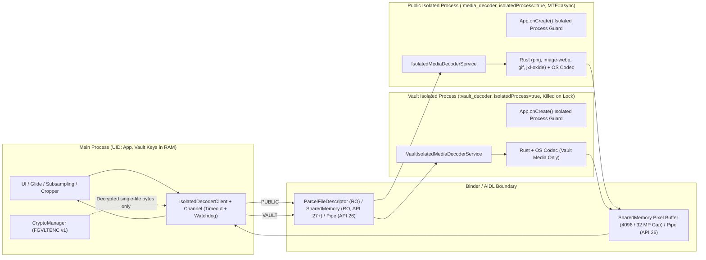

# ADR 0009: Isolated Media Decoding Architecture (`android:isolatedProcess="true"`)

- **Status:** Completed (Phases 0–6 — Final)
- **Date:** 2026-11-27
- **Goal:** Fully isolate media formats that rely on untrusted or third-party C/C++ native decoders from the main application process, and provide defense-in-depth with a memory-safe Rust decoder layer inside the isolated process.

---

## 1. Context and Threat Model

Calypso Gallery keeps vault keys and decrypted user session data in the RAM of the main application process. The application previously depended on the following C/C++ JNI and platform media decoders:

- **GIF:** `pl.droidsonroids.gif:android-gif-drawable` (`giflib` — C + JNI)
- **WebP:** `com.github.zjupure:webpdecoder` (`libwebp` — C/C++ + JNI; used instead of the system decoder due to `CVE-2023-4863`)
- **AVIF:** Platform `ImageDecoder` (`dav1d` / Mainline) inside the isolated process on Android 12+ (`API 31+`); the bundled `glide:avif-integration` (`libavif`/`libaom`) C++ dependency has been removed (future `rav1d` evaluation for Android 8–11 is tracked in `TODO.md`)
- **JPEG XL:** `io.github.awxkee:jxl-coder-glide` (Rust + C/C++ `libjxl` NDK; support is preserved by moving to pure-Rust `jxl-oxide` in Phase 4)
- **JPG / PNG / HEIC / RAW:** Android `BitmapFactory` / `ImageDecoder` / `BitmapRegionDecoder` (Skia / `libjpeg-turbo` / DNG codecs)
- **SVG:** `com.caverock:androidsvg-aar` (Pure Java; while RCE risk is low, malformed SVGs carry OOM / CPU DoS risk)

Moving all of these decoders to a memory-safe language (e.g., Rust) alone is not sufficient and introduces significant trade-offs:
- **Loss of platform features:** Using only Rust crates for JPEG/PNG would sacrifice mature platform capabilities such as ICC / wide color gamut, HDR / Ultra HDR gain maps, and progressive/CMYK/corrupt-file tolerance.
- **OS patch lag (`minSdk = 26`):** Even though `Skia`, `libjpeg-turbo`, and `libpng` are heavily fuzzed, patches only reach users through OEM/OS security updates; unpatched vulnerabilities can persist for years on Android 8–12 devices.
- **Risks Rust cannot eliminate:** Decompression bombs, excessive memory consumption, infinite loops, and uncaught `panic` crashes across FFI boundaries are still possible in Rust.

By contrast, using **privilege separation** to move all media decoding into a separate service marked `android:isolatedProcess="true"`:

1. Confines any RCE / heap overflow / UAF triggered inside a decoder to the **`isolated_app` SELinux sandbox** and kernel **`seccomp-bpf`** filter (no app UID, no filesystem access, no network access, no access to system services).
2. Preserves `minSdk = 26` (Android 8.0); `isolatedProcess="true"`, `isolated_app` SELinux, and `seccomp-bpf` have been active since API 26 (`android:useAppZygote="true"` is intentionally not used for the reasons explained in Section 5).
3. Prevents an attacker from reaching vault keys (`CryptoManager`) in main-process RAM or other files on disk.
4. Ensures OOMs, infinite loops (DoS), or `SIGSEGV` crashes only terminate the isolated service while the main application stays alive.
5. Makes it straightforward in Phase 4 to replace high-risk C/C++ decoders *inside* the isolated process (`giflib`, `libwebp`, `libjxl`, `png`/`jpeg`) with pure-Rust crates (`rust/calypso-media/`).

---

## 2. Scope and Main-Process Decode Inventory

### Isolated Layers
- **Static raster images:** `JPG`, `JPEG`, `PNG`, `WebP`, `AVIF`, `JXL`, `HEIC`, `RAW/DNG`, `APNG` (first frame)
- **Animated images:** Fullscreen playback for `GIF`, `APNG`, and animated `WebP` (via pure-Rust `calypso-media` double-buffered `SharedMemory` sessions); `aAVIF` and all grid thumbnails remain static first-frame renders
- **Vector images:** `SVG` (for OOM and CPU DoS isolation)
- **Dimension/bounds probing, thumbnails, and region decoding:**
  - Embedded thumbnails generated during vault encryption in `CryptoManagerFileCrypto` (`BitmapFactory`)
  - `LibraryGlideModule`s automatically wired into the main process by Glide and KSP (`zjupure:webpdecoder`, `avif-integration`, `jxl-coder-glide`, internal `BitmapFactory`/`GifDecoder`)
  - `PhotoFragment` and `PicassoRegionDecoder` (`SubsamplingScaleImageView` region/tile decoding)
  - `EditActivity` and `SetWallpaperActivity` (isolated decoded `Bitmap` instead of `CropImageView.setImageUriAsync`)
  - `ViewPagerFragment` (`JxlCoder.getSize`) and `fossify-commons` `getResolution` / `getImageResolution` calls (`ViewPagerActivity`, `Activity.kt`)
  - `MediaDimensions`, `SmartFileConflictDialog`, `Activity.kt` rotation/bitmap operations, and `MyWidgetProvider`

### Out of Scope (Remaining in Main Process)
1. **Video (`MP4`, `MKV`, `WebM` — `Media3 ExoPlayer`):**
   - ExoPlayer's container/demuxer layer is pure Java/Kotlin; native video decoding (`MediaCodec` / `media.extractor` / `media.swcodec`) is already executed by Android OS in separate sandboxed processes.
2. **EXIF / Metadata (`androidx.exifinterface`):**
   - Pure Java; abandoned `it.sephiroth.android.exif` and `org.apache.sanselan` dependencies were removed in Phase 0.

---

## 3. Final Architecture

### 3.1. `App.onCreate()` Isolated Process Guard
- Android also invokes `Application.onCreate()` (`App.kt`) when starting an `android:isolatedProcess="true"` service.
- At the very start of `App.onCreate()`, isolated-process detection (`Process.isIsolated()` on API 28+ or `Process.myUid()` in `99000..99999` fallback on API 26–27) must return early before invoking `OperationJournal`, `SharedPreferences` (`config`), `PackageManager` (`AppearanceManager.applyLauncherIcon`), or `registerReceiver`.

### 3.2. Input Transfer (Zero-Copy / Read-Only)
- **Public (unencrypted) files:** The main process opens the file as a read-only `ParcelFileDescriptor` (`MODE_READ_ONLY`) and passes it over Binder to the isolated service. The isolated service cannot see the file path or other directories.
- **Encrypted vault files (`FGVLTENC` v1):** After decrypting the file in memory, the main process ([EncryptedGlideLoader.kt](file:///c:/Users/ben/Desktop/Calypso-Gallery/app/src/main/kotlin/org/fossify/gallery/helpers/EncryptedGlideLoader.kt) and `CryptoManagerFileCrypto`) passes only that single file's bytes over **read-only `SharedMemory`** (API 27+, sealed with `OsConstants.PROT_READ`) or **`ParcelFileDescriptor.createPipe()`** (API 26) to the isolated service. The isolated process never sees the vault key.

### 3.3. Output Transfer (`SharedMemory` Pixel Buffer — GPU/OEM Independent)
- On many OEM devices, the `isolated_app` SELinux policy under `android:isolatedProcess="true"` denies isolated processes access to GPU drivers (`/dev/kgsl`, `/dev/mali`), `gralloc`, and `SurfaceFlinger` HALs. Moreover, `Bitmap.wrapHardwareBuffer` requires API 28+.
- Therefore, a **`SharedMemory` CPU pixel buffer (API 27+) + `ParcelFileDescriptor` pipe (API 26)** model is used across all devices (API 26–36) for stability and zero GPU dependency:
  - The isolated process decodes the image into a raw `ARGB_8888` / RGBA pixel buffer, seals the buffer as `PROT_READ` (single-shot decode) or uses double-buffered sharing, and returns only width, height, and the `SharedMemory`/`ParcelFileDescriptor` handle to the main process.
  - **Main-process output validation ([IsolatedPixelTransport.kt](file:///c:/Users/ben/Desktop/Calypso-Gallery/app/src/main/kotlin/org/fossify/gallery/helpers/media/IsolatedPixelTransport.kt)):** Even if the isolated process is compromised, `isValidTransferDimensions` strictly enforces a maximum dimension of `4096` pixels, a maximum total pixel count of `32 MP` (`33_554_432` pixels = `128 MiB`), and matching `SharedMemory.size` bounds to prevent OOMs in the main process.
  - The main process copies the pixel bytes into its own `Bitmap`, working seamlessly with Glide caching, `GestureImageView`, `SubsamplingScaleImageView`, and `CropImageView` without an extra compatibility layer.

---

## 4. Animated Images and Region (Tile) Decoding Design

### 4.1. Grid / Thumbnails: Removal of `animateGifs` (Completed in Phase 0)
- The *"Animate GIFs at thumbnails"* (`ANIMATE_GIFS` / `animateGifs`) setting and the `penfeizhou` (`apng`, `awebp`, `avif`) libraries were removed.
- Thumbnails for all static and animated formats are decoded as a single static first frame only, eliminating the parallel animation attack surface and unnecessary IPC load during grid scrolling.

### 4.2. Fullscreen Animated Playback: Option B (`SharedMemory` Double Buffer — GIF, APNG, and Animated WebP)
- In fullscreen mode, **GIF**, **APNG**, and **animated WebP** are played back through a unified session stream (`IsolatedGifSessionStore` → `calypso-media` `gif_session` / `animated_session`) (`aAVIF` and grid thumbnails remain static first-frame renders).
- Without adding new third-party native dependencies (`penfeizhou`, etc.), the existing pure-Rust crates `gif (0.14.2)`, `png (0.18.1)`, and `image-webp (0.2.4)` are used; a fullscreen animation session is only opened when container header sniffing detects animation (`GIF` / `acTL` / `VP8X ANIM`), avoiding double IPC for static PNG/WebP files.
- **Option B (`SharedMemory` double-buffered frame streaming)** was chosen over Option A (`Surface` transfer):
  - 100% compatible with `isolated_app` SELinux rules; produces no GPU/OEM instability.
  - Works naturally with `GestureImageView` pinch-to-zoom / pan and `ViewPager2` transitions.

### 4.3. Region Decoding for Large Images (`SubsamplingScaleImageView`)
- Instead of running `BitmapRegionDecoder` directly in the main process, `PicassoRegionDecoder` opens a region-decoder session in the isolated service and requests isolated tile decodes using only `Rect` + `sampleSize` parameters.

---

## 5. Input Hardening, Process Lifecycle, and Resilience

1. **Input Limits (Decompression Bomb Protection):**
   - Pixel dimensions are always probed before full decoding; excessive resolutions above the threshold are rejected, and `inSampleSize` / target dimensions matching the target view are enforced.
   - All `Throwable` errors inside the isolated service (and `panic` conditions at the Rust FFI boundary) are caught.
2. **RAW / DNG Strategy:**
   - During listing/thumbnailing, decoding the embedded JPEG preview in the isolated process is preferred; full RAW decoding runs in the isolated process only when required for fullscreen viewing.
3. **Dual-Channel Warm Workers and Vault Process Separation (`:media_decoder` vs. `:vault_decoder`):**
   - While the app is in the foreground, normal/external media is decoded in `IsolatedMediaDecoderService` (`:media_decoder` — `PUBLIC` channel), whereas decrypted vault media is decoded in a separate `VaultIsolatedMediaDecoderService` (`:vault_decoder` — `VAULT` channel). Thus, a process compromised while handling an untrusted external image cannot access vault media opened before or after in the same process memory.
   - GIF and Region sessions carry their own channel identifier (`PUBLIC` / `VAULT`), preventing `sessionId` counter collisions across the two processes.
   - When the vault is locked, `CryptoManager.lockVaultInternal` directly calls `VaultDecoderLifecycle.onVaultLocked` to immediately disconnect (`unbindService`) and kill `:vault_decoder`; when backgrounded, both channels are released after a controlled delay.
   - **Decision not to use `android:useAppZygote="true"`:** Warm isolated workers already avoid repeated cold starts; by contrast, `useAppZygote="true"` keeps an extra persistent App Zygote process in RAM and causes respawned isolated processes after a watchdog kill/crash to inherit the same ASLR address layout. Therefore, it was not used.
4. **Timeouts (Watchdog) and Crash Resilience:**
   - If a fixed request timeout (`20 s` static/open, `5 s` GIF frame render) is exceeded, the corresponding isolated process channel is terminated via `unbindService` and restarted.
   - On `onBindingDied` / `onServiceDisconnected`, the main process does not crash; the offending file identifier is temporarily quarantined (`60 s`) via `IsolatedFailureQuarantine` to prevent crash loops.
5. **In-Process Memory Hardening (`MTE`) and DoS Caps:**
   - `android:memtagMode="async"` is enabled in [AndroidManifest.xml](file:///c:/Users/ben/Desktop/Calypso-Gallery/app/src/main/AndroidManifest.xml) to catch memory corruption with low overhead in both the main and isolated processes on ARMv9-capable devices (e.g., Pixel 8+).
   - Because `jxl-oxide` uses an `f32` framebuffer, JXL source pixels are capped at `32 MP` (`MAX_JXL_SOURCE_PIXELS`), and lossless WebP (`VP8L`) also enforces a `32 MP` cap without falling back to C `libwebp`.

---

## 6. Phased Implementation Roadmap

- **Phase 0 — Cleanup and Scope Reduction (Completed):**
  - Removed `org.apache.sanselan` and `it.sephiroth.android.exif` and migrated [PhotoFragment.kt](file:///c:/Users/ben/Desktop/Calypso-Gallery/app/src/main/kotlin/org/fossify/gallery/fragments/PhotoFragment.kt) entirely to `androidx.exifinterface`.
  - Removed the `animateGifs` setting, UI row, adapter/activity hooks, and `penfeizhou` (`apng`, `awebp`, `avif`) dependencies.
- **Phase 1 — Isolated Media Service + Static Decode & Vault Thumbnail Pipeline (Completed):**
  - Added `IsolatedMediaDecoderService` (`android:isolatedProcess="true"`), AIDL interface, `SharedMemory` (API 27+) / pipe (API 26) return transport, watchdog/timeout, failure quarantine, and `App.onCreate()` isolated-process guard.
  - Routed Glide main-process integration (disabling automatic native `LibraryGlideModule`s) to the isolated client.
  - Migrated `CryptoManagerFileCrypto` embedded thumbnail generation, `MediaDimensions`, `SmartFileConflictDialog`, `ViewPagerFragment`, `Activity.kt`, and `MyWidgetProvider` static decode/bounds calls to the isolated service.
- **Phase 2 — Isolated Tile/Region Decode & Editor / Wallpaper (Completed):**
  - Added an isolated `BitmapRegionDecoder` session (`Rect + sampleSize`) for `PicassoRegionDecoder` (`SubsamplingScaleImageView`).
  - Migrated `EditActivity` and `SetWallpaperActivity` (`CropImageView`) inputs to isolated bitmaps and routed `fossify-commons` `getResolution`/`getImageResolution` calls to the isolated bounds-probing pipeline.
- **Phase 3 — Fullscreen Isolated GIF Player & Security Contract Tests (Completed):**
  - Built the `SharedMemory` double-buffered (with pipe fallback on API 26) `IsolatedGifSessionStore` / `IsolatedGifClient` / `IsolatedGifDrawable` player; removed `pl.droidsonroids.gif` (`GifTextureView`) from [PhotoFragment.kt](file:///c:/Users/ben/Desktop/Calypso-Gallery/app/src/main/kotlin/org/fossify/gallery/fragments/PhotoFragment.kt) and [pager_photo_item.xml](file:///c:/Users/ben/Desktop/Calypso-Gallery/app/src/main/res/layout/pager_photo_item.xml).
  - Added repository-wide contract tests (`IsolatedMediaDecodingPolicyTest`) guaranteeing no direct native media decoder calls remain in the main process or XML layouts, along with timing/buffer tests (`IsolatedGifTimingPolicyTest`).
- **Phase 4 — Hybrid Isolated Media Architecture & Lightweight Pure Rust (`rust/calypso-media/`) (Completed):**
  - Completely removed high-risk third-party C/C++ libraries from the isolated process (`giflib` / `android-gif-drawable`, `zjupure:webpdecoder`, `jxl-coder-glide` / `libjxl` / `lcms2`) and moved JXL (`jxl-oxide`) and static/animated GIF (`gif` — O(1) memory `SharedMemory` double-buffered prefetch) into the pure-Rust `calypso-media` (`libcalypso_media.so`) crate.
  - Returned JPEG, PNG, and WebP decoding inside the isolated process to Android OS's hardware/NEON-accelerated built-in codecs (`BitmapFactory` / `ImageDecoder`) with DCT `inSampleSize` support, restoring gallery grid smoothness on low/mid-tier devices while preserving 100% main-process isolation.
- **Phase 5 — Vault Process Separation, MTE, Output/JXL Caps, Default-Off SVG, and Pure-Rust PNG + Hybrid WebP (Completed):**
  - **Process separation and MTE:** Split normal media (`:media_decoder`) and encrypted vault media (`:vault_decoder`) into two separate `isolatedProcess="true"` services; `:vault_decoder` is immediately killed when the vault locks. Added `android:memtagMode="async"` at the manifest level.
  - **Output and DoS caps:** Tightened `IsolatedPixelTransport` main-process ingestion limits to `4096` / `32 MP` (`128 MiB`); added `MAX_JXL_SOURCE_PIXELS = 32 MP` for `jxl-oxide`.
  - **SVG default-off (fail-closed):** Made the legacy/unmaintained `androidsvg-aar` engine completely unreachable by default (`showSvgFiles = false`, removed `TYPE_SVGS` from `getDefaultFileFilter()`, deleted `MainActivity` auto-migration). Without `FLAG_ALLOW_SVG` at the `:media_decoder` boundary, external `ACTION_VIEW` intents and spoofed `.jpg`/`.png` SVGs are rejected with `STATUS_UNSUPPORTED`. The setting can only be enabled via confirmation dialog under **Settings → Media Viewer → Media Security → Show SVG files**.
  - **Pure-Rust `png (0.18.1)` (`fdeflate`) + Hybrid `image-webp (0.2.4)` — Option A (Implemented):**
    - **PNG:** Bounds probing (`probeBounds`) and static decoding use pure-Rust `png` (`128 MiB` memory limit). Corrupt PNGs are strictly rejected with `DecodeFailed` (C `libpng` fallback is forbidden); in Phase 5, `> 32 MP` PNGs were deferred to the isolated OS codec, whereas Phase 6 moved non-interlaced PNGs into Rust row-by-row streaming as well, leaving only `> 32 MP` *interlaced* PNGs to `DeferToPlatform` in the isolated OS codec.
    - **WebP — Option A (Implemented, hybrid model):** Bounds probing uses pure-Rust `image-webp`. **Lossless (`VP8L`, the `CVE-2023-4863` attack surface)** is always decoded in pure Rust; corrupt `VP8L` or `> 32 MP` files **never** fall back to C `libwebp` (`DecodeFailed` / `TooLarge`). **Lossy (`VP8 `)** is decoded in pure Rust up to `4 MP` (`MAX_RUST_LOSSY_WEBP_PIXELS = 4_000_000`); only valid `> 4 MP` lossy or animated WebP files defer via `DeferToPlatform` to the isolated OS codec.
    - **WebP — Option B (Alternative, full pure-Rust static WebP):** Decoding all static WebP (`VP8L` + `VP8 `) files in pure-Rust `image-webp` and deferring only animated or unsupported WebP files to the isolated OS codec. This avoids touching system `libwebp` even for large (`> 4 MP`) lossy WebPs, at the cost of a ~4–10× slowdown on large lossy WebPs due to missing lossy SIMD in `image-webp`. Once `image-webp` lossy SIMD support matures, removing `MAX_RUST_LOSSY_WEBP_PIXELS` switches directly to Option B.
- **Phase 6 — Ultra HDR (`Gainmap`), Pure-Rust APNG/aWebP, Row-Streaming >32 MP PNG, Large-File FD Streaming, and Swipe/Pool Optimizations (Completed — Final):**
  - **Ultra HDR (`Gainmap`, API 34+) & Wide Color Gamut (`Display P3` / `BT2020`):** [IsolatedHdrTransport.kt](file:///c:/Users/ben/Desktop/Calypso-Gallery/app/src/main/kotlin/org/fossify/gallery/helpers/media/IsolatedHdrTransport.kt) keeps all MPF/XMP/tmap/ICC parsing inside the isolated OS codec. Only when `FLAG_INCLUDE_GAINMAP` is requested (fullscreen with `ultraHdrRendering == true`) does the main process receive the raw Gainmap pixel buffer (`ALPHA_8` / `ARGB_8888`, dimensions bounded by the base image), `isFinite()` + range-clamped 17 scalar float metadata values, and a fixed `ColorSpace.Named` ID over `SharedMemory`.
  - **Zero-New-Dependency Pure-Rust APNG & Animated WebP:** [animated_session.rs](file:///c:/Users/ben/Desktop/Calypso-Gallery/rust/calypso-media/src/animated_session.rs) connects `png (0.18.1)` (`acTL`/`fcTL`/`fdAT` + `DisposeOp` + `BlendOp`) and `image-webp (0.2.4)` (`is_animated()` / `read_frame`) to the existing `SharedMemory` double-buffered `IsolatedGifSessionStore` / `IsolatedGifDrawable` pipeline. [IsolatedFormatSniffer.kt](file:///c:/Users/ben/Desktop/Calypso-Gallery/app/src/main/kotlin/org/fossify/gallery/helpers/media/IsolatedFormatSniffer.kt) (`hasAnimatedContainerHint`) opens animation sessions in pure Kotlin only for APNG/aWebP/GIF, avoiding extra IPC for static images.
  - **Row-by-Row (`read_row`) Pure-Rust Decode for Large (`> 32 MP`) PNGs:** [png_webp_decoders.rs](file:///c:/Users/ben/Desktop/Calypso-Gallery/rust/calypso-media/src/png_webp_decoders.rs) decodes non-interlaced PNGs `> 32 MP` (up to `300 MP`) row by row (`reader.read_row`) with `O(width)` memory and performs premultiplied box-average downscaling inside Rust, eliminating C `libpng` fallback for non-interlaced PNGs as well.
  - **`ParcelFileDescriptor` Streaming for Large RAW / TIFF / JPEG / HEIC (`> 100 MiB` → `512 MiB`):** [IsolatedFdStreamingCodecs.kt](file:///c:/Users/ben/Desktop/Calypso-Gallery/app/src/main/kotlin/org/fossify/gallery/helpers/media/IsolatedFdStreamingCodecs.kt) and [IsolatedRegionDecoderStore.kt](file:///c:/Users/ben/Desktop/Calypso-Gallery/app/src/main/kotlin/org/fossify/gallery/helpers/media/IsolatedRegionDecoderStore.kt) decode and open region (tile) sessions for seekable files over `100 MiB` (up to `512 MiB`) directly via `FileDescriptor` / `ParcelFileDescriptor.dup` without allocating a full `ByteArray` copy.
  - **Fullscreen Swipe, Vault Bitmap Pooling, and Metadata Caching:**
    - [VaultBitmapPool.kt](file:///c:/Users/ben/Desktop/Calypso-Gallery/app/src/main/kotlin/org/fossify/gallery/helpers/media/VaultBitmapPool.kt) zeroes and reuses encrypted vault bitmaps on release; [IsolatedMetadataCache.kt](file:///c:/Users/ben/Desktop/Calypso-Gallery/app/src/main/kotlin/org/fossify/gallery/helpers/media/IsolatedMetadataCache.kt) caches dimensions/EXIF orientation to avoid repeated IPC.
    - [PhotoSwipeOptimizer.kt](file:///c:/Users/ben/Desktop/Calypso-Gallery/app/src/main/kotlin/org/fossify/gallery/helpers/media/PhotoSwipeOptimizer.kt) skips unnecessary animation probing on static extensions (`isDefinitelyStaticByPath`) and keeps adjacent GIF/APNG/aWebP sessions animating smoothly during `ViewPager` swipes (`shouldKeepAnimatedPlaying`).
- **Follow-Up Topics:**
  - **AVIF / HEIC / RAW strategy implemented:**
    - `glide:avif-integration` removed (Option 2); Android 12+ (`API 31+`) uses isolated `ImageDecoder`. No third-party C/C++ image `.so` remains. Adding pure-Rust `rav1d` + `mp4parse` to `rust/calypso-media/` (Option 3) for Android 8–11 (`API 26–30`) AVIF support and defense-in-depth is tracked in [TODO.md](file:///c:/Users/ben/Desktop/Calypso-Gallery/TODO.md).
    - HEIC, RAW/DNG, and embedded RAW previews are decoded in the isolated process via Android OS codecs (`BitmapFactory` / `ImageDecoder` / `media.swcodec`).
  - ~~Replacing the `androidphotofilters` (`libNativeImageProcessor.so`) C++ JNI filter library in `EditActivity` with pure Kotlin (`ColorMatrix` / LUT)~~ (**Completed:** pure-Kotlin filter engine moved under `helpers/filters/`).

---

## 7. Backward Compatibility, Platform Boundaries, and Known Trade-Offs

Summary of compatibility for the isolated media architecture and Phases 0–6 changes against older Calypso / original Fossify Gallery versions and Android API levels:

| Area / Feature | Current State (Phase 6 Final) | Difference vs. Original Fossify / Previous State | Notes |
|---|---|---|---|
| **AVIF** | **Android 12+ (`API 31+`)** OS `ImageDecoder` only (in isolated process) | Original Fossify opened AVIF on API 26–30 via bundled `avif-integration` (`libavif`/`dav1d`) | AVIF does not open on API 26–30; C++ JNI was not bundled for security and APK size |
| **HEIC / HEIF** | **Android 9+ (`API 28+`)** full OS support; API 26–27 only if OEM `BitmapFactory` supports it | Same | No extra third-party C++ codec |
| **API 26 IPC Transfer** | `ParcelFileDescriptor` pipe fallback (`SharedMemory` requires API 27+) | Direct read in main process | Works on API 26, though memory copy is slower than on API 27+ |
| **MTE (`android:memtagMode="async"`)** | Active on ARMv9 / Android 13+ devices | Not present | Silently ignored by Android on older/unsupported devices; no compatibility issue |
| **Animated Media (GIF / APNG / aWebP)** | Fullscreen **GIF, APNG, and Animated WebP** played via pure-Rust engine (`SharedMemory` double buffer) | Original Fossify used `giflib` + `penfeizhou` (C++) | `aAVIF` and all grid thumbnails remain static first-frame renders for security |
| **Grid GIF Animation** | Disabled (static first frame only) | Had `animateGifs` setting | Parallel animation load and attack surface during scrolling removed |
| **SVG Support** | **Disabled by default** (can be enabled with confirmation under Settings → Media Viewer → Media Security) | Enabled by default (auto-enabled via `wasSVGShowingHandled`) | Also disabled automatically for updating users; `androidsvg` is 100% unreachable when off |
| **DoS / Resource Limits** | RAM copy max `100 MiB`; large RAW/JPEG/HEIC/TIFF FD streaming max `512 MiB`; **JXL** & **Lossless WebP** max `32 MP`; non-interlaced PNG row streaming `300 MP`; output cap `4096` / `32 MP` | Unbounded (OOM risk) | Professional RAW/camera files `> 100 MiB` open via isolated FD and tiles without loading the full file into memory |
| **Ultra HDR (`Gainmap`) & Wide Color Gamut** | **Active in fullscreen** (`Display P3`/`BT2020` API 26+; `Gainmap` API 34+, `SharedMemory` + scalar-validated IPC) | Main process received OS bitmap directly for HDR/P3 | MPF/XMP/ICC parsing stays 100% in the isolated process; works with [ColorModeHelper.kt](file:///c:/Users/ben/Desktop/Calypso-Gallery/app/src/main/kotlin/org/fossify/gallery/helpers/ColorModeHelper.kt) |
| **Encrypted Vault (`FGVLTENC` v1), CLI Bridge, Settings Backups** | **100% backward compatible** | Same format | Legacy vault files, `.bin`/`.vault`, and settings export/import files work seamlessly (`show_svg_files` defaults to `false` when absent) |

---

## 8. Ultra HDR (`Gainmap`) and Wide Color Gamut Secure IPC Design (Implemented in Phase 6)

[IsolatedHdrTransport.kt](file:///c:/Users/ben/Desktop/Calypso-Gallery/app/src/main/kotlin/org/fossify/gallery/helpers/media/IsolatedHdrTransport.kt) transfers Android 14+ (`API 34+`) Ultra HDR photos and wide color gamut images to the main process without weakening the isolated process boundary:

1. **All parsing stays in the isolated process:** JPEG MPF, XMP Gainmap metadata, and HEIC `tmap` parsing are performed entirely inside `:media_decoder` / `:vault_decoder` by OS `BitmapFactory` / `ImageDecoder`; [IsolatedBitmapTransforms.kt](file:///c:/Users/ben/Desktop/Calypso-Gallery/app/src/main/kotlin/org/fossify/gallery/helpers/media/IsolatedBitmapTransforms.kt) also applies EXIF rotation and scaling to the Gainmap. Compressed HDR/ICC bytes are never processed in the main process.
2. **Fullscreen only (`FLAG_INCLUDE_GAINMAP`):** Not requested for thumbnails; only requested during fullscreen viewing (`IsolatedGlideOptions.INCLUDE_GAINMAP`) when `Build.VERSION.SDK_INT >= 34` and `config.ultraHdrRendering == true`.
3. **Minimal, validated IPC payload ([IsolatedMediaModels.kt](file:///c:/Users/ben/Desktop/Calypso-Gallery/app/src/main/kotlin/org/fossify/gallery/helpers/media/IsolatedMediaModels.kt) `IsolatedHdrPayload`):**
   - **Gainmap raw pixel buffer:** `ALPHA_8` (1 bpp) or `ARGB_8888` (4 bpp) pixel buffer transferred via `PROT_READ`-sealed `SharedMemory`; the main process verifies dimensions do not exceed the base image (`<= baseWidth x baseHeight`) and byte size matches the channel size.
   - **17 scalar `float` metadata values:** `ratioMin[3]`, `ratioMax[3]`, `gamma[3]`, `epsilonSdr[3]`, `epsilonHdr[3]`, `minDisplayRatioForHdrTransition`, `displayRatioForFullHdr` — all verified with `isFinite()` in the main process and clamped to safe ranges (`sanitizeGainmapMeta`).
   - **Color space ID (`COLOR_SPACE_*`):** Only fixed `SRGB`, `DISPLAY_P3`, `BT2020`, `DCI_P3`, `ADOBE_RGB` enum IDs are transferred instead of arbitrary ICC profile bytes.
4. **Main-process assembly:** [IsolatedPixelTransport.kt](file:///c:/Users/ben/Desktop/Calypso-Gallery/app/src/main/kotlin/org/fossify/gallery/helpers/media/IsolatedPixelTransport.kt) constructs the base bitmap with the validated `ColorSpace`, attaches the `Gainmap`, and [ColorModeHelper.kt](file:///c:/Users/ben/Desktop/Calypso-Gallery/app/src/main/kotlin/org/fossify/gallery/helpers/ColorModeHelper.kt) enables `ActivityInfo.COLOR_MODE_HDR` or `COLOR_MODE_WIDE_COLOR_GAMUT`.
