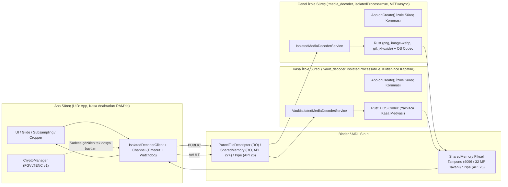

# ADR 0009: İzole Medya Çözme Mimarisi (`android:isolatedProcess="true"`)

- **Durum:** Tamamlandı (Faz 0–6 — Final)
- **Tarih:** 2026-11-27
- **Hedef:** Güvenilmeyen veya üçüncü parti C/C++ yerel (native) decoder kullanan medya formatlarını ana uygulama sürecinden tamamen izole etmek ve ilerleyen fazlarda izole süreç içi bellek-güvenli Rust decoder katmanı ile derinlemesine savunma sağlamak.

---

## 1. Bağlam ve Tehdit Modeli

Calypso Gallery, kasa (vault) anahtarlarını ve çözülmüş kullanıcı oturum verilerini ana uygulama sürecinin RAM'inde tutar. Uygulama aşağıdaki C/C++ JNI ve platform medya çözücülerine bağımlıdır:

- **GIF:** `pl.droidsonroids.gif:android-gif-drawable` (`giflib` — C + JNI)
- **WebP:** `com.github.zjupure:webpdecoder` (`libwebp` — C/C++ + JNI; `CVE-2023-4863` nedeniyle sistem decoder yerine kullanılıyor)
- **AVIF:** Android 12+ (`API 31+`) cihazlarda izole süreç içindeki platform `ImageDecoder` (`dav1d` / Mainline); gömülü `glide:avif-integration` (`libavif`/`libaom`) C++ bağımlılığı kaldırılmıştır (Android 8–11 için gelecekte `rav1d` değerlendirmesi `TODO.md` içinde takip edilir)
- **JPEG XL:** `io.github.awxkee:jxl-coder-glide` (Rust + C/C++ `libjxl` NDK; Faz 4'te saf Rust `jxl-oxide`'a geçeceği için destek korunur)
- **JPG / PNG / HEIC / RAW:** Android `BitmapFactory` / `ImageDecoder` / `BitmapRegionDecoder` (Skia / `libjpeg-turbo` / DNG codec'leri)
- **SVG:** `com.caverock:androidsvg-aar` (Saf Java; RCE riski düşük olsa da hatalı SVG'lerde OOM / CPU DoS riski taşır)

Bu decoder'ların tamamını bellek güvenli bir dile (ör. Rust) taşımak tek başına yeterli değildir ve ciddi ödünleşimler doğurur:
- **Platform özelliklerinin kaybı:** JPEG/PNG tarafında yalnızca Rust crate'leri kullanmak; ICC / geniş renk gamutu, HDR / Ultra HDR gain map, progressive/CMYK/bozuk dosya toleransı gibi olgun platform özelliklerini kaybetmeye yol açar.
- **OS yama gecikmesi (`minSdk = 26`):** `Skia`, `libjpeg-turbo` ve `libpng` yoğun fuzzing görse de yamalar kullanıcılara yalnızca OEM/OS güvenlik güncellemeleriyle ulaşır; güncelleme almayan Android 8–12 cihazlarda eski açıklar yıllarca kalabilir.
- **Rust'ın çözemediği riskler:** Decompression bomb, aşırı bellek tüketimi, sonsuz döngü ve FFI sınırında yakalanmayan `panic` çökmeleri Rust'ta da mümkündür.

Buna karşılık **yetki ayrımı (privilege separation)** yaklaşımıyla tüm medya çözümlemesini `android:isolatedProcess="true"` işaretli ayrı bir servise taşımak:

1. Decoder içinde bir RCE / heap overflow / UAF açığı tetiklense bile saldırganı **`isolated_app` SELinux sandbox'ı** ve çekirdek **`seccomp-bpf`** filtresi içinde hapseder (uygulama UID'si yok, dosya sistemi erişimi yok, ağ erişimi yok, sistem servislerine erişim yok).
2. `minSdk = 26` (Android 8.0) korunur; `isolatedProcess="true"`, `isolated_app` SELinux ve `seccomp-bpf` API 26'dan beri aktiftir (`android:useAppZygote="true"` ise Bölüm 5'teki nedenlerle bilinçli olarak kullanılmamıştır).
3. Saldırganın ana süreç RAM'indeki kasa anahtarlarına (`CryptoManager`) veya diskteki diğer dosyalara ulaşmasını engeller.
4. OOM, sonsuz döngü (DoS) veya `SIGSEGV` çökmelerinde yalnızca izole servisin kapanmasını sağlar; ana uygulama ayakta kalır.
5. Faz 4'te izole sürecin *içindeki* yüksek riskli C/C++ decoder'ların (`giflib`, `libwebp`, `libjxl`, `png`/`jpeg`) saf Rust crate'lerle (`rust/calypso-media/`) değiştirilmesini kolaylaştırır.

---

## 2. Kapsam ve Ana Süreç Decode Envanteri

### İzole Edilecek Katmanlar
- **Statik raster görseller:** `JPG`, `JPEG`, `PNG`, `WebP`, `AVIF`, `JXL`, `HEIC`, `RAW/DNG`, `APNG` (ilk kare)
- **Animasyonlu görseller:** Yalnızca `GIF` (tam ekran); `aWebP`, `APNG`, `aAVIF` statik ilk kareye düşürülür
- **Vektör görseller:** `SVG` (OOM ve CPU DoS izolasyonu için)
- **Boyut/sınır okuma, küçük resim ve bölgesel çözme:**
  - `CryptoManagerFileCrypto` içindeki kasa şifreleme sırasında üretilen gömülü küçük resimler (`BitmapFactory`)
  - Glide ve KSP tarafından ana süreçte otomatik bağlanan `LibraryGlideModule`'ler (`zjupure:webpdecoder`, `avif-integration`, `jxl-coder-glide`, dahili `BitmapFactory`/`GifDecoder`)
  - `PhotoFragment` ve `PicassoRegionDecoder` (`SubsamplingScaleImageView` bölgesel/tile decode)
  - `EditActivity` ve `SetWallpaperActivity` (`CropImageView.setImageUriAsync` yerine izole çözülmüş `Bitmap`)
  - `ViewPagerFragment` (`JxlCoder.getSize`) ve `fossify-commons` `getResolution` / `getImageResolution` çağrıları (`ViewPagerActivity`, `Activity.kt`)
  - `MediaDimensions`, `SmartFileConflictDialog`, `Activity.kt` döndürme/bitmap işlemleri ve `MyWidgetProvider`

### Kapsam Dışı (Ana Süreçte Kalacaklar)
1. **Video (`MP4`, `MKV`, `WebM` — `Media3 ExoPlayer`):**
   - ExoPlayer'ın container/demuxer katmanı saf Java/Kotlin'dir; native video çözme (`MediaCodec` / `media.extractor` / `media.swcodec`) Android OS tarafından zaten ayrı sandbox süreçlerinde çalıştırılır.
2. **EXIF / Metadata (`androidx.exifinterface`):**
   - Saf Java'dır; terk edilmiş `it.sephiroth.android.exif` ve `org.apache.sanselan` bağımlılıkları Faz 0'da kaldırılmıştır.

---

## 3. Kesinleşen Mimari

### 3.1. `App.onCreate()` İzole Süreç Koruması
- Android, `android:isolatedProcess="true"` servisi başlatırken de `Application.onCreate()` (`App.kt`) metodunu çalıştırır.
- `App.onCreate()` en başında izole süreç tespiti (`Process.isIsolated()` API 28+ veya `Process.myUid()` `99000..99999` API 26–27 fallback) yapılmalı ve izole süreçteyken `OperationJournal`, `SharedPreferences` (`config`), `PackageManager` (`AppearanceManager.applyLauncherIcon`) veya `registerReceiver` çağrılmadan erken dönülmelidir.

### 3.2. Girdi Aktarımı (Zero-Copy / Salt-Okunur)
- **Genel (şifresiz) dosyalar:** Ana süreç dosyayı salt-okunur `ParcelFileDescriptor` (`MODE_READ_ONLY`) olarak açar ve Binder üzerinden izole servise verir. İzole servis dosya yolunu veya diğer dizinleri göremez.
- **Şifreli kasa dosyaları (`FGVLTENC` v1):** Ana süreç ([EncryptedGlideLoader.kt](file:///c:/Users/ben/Desktop/Calypso-Gallery/app/src/main/kotlin/org/fossify/gallery/helpers/EncryptedGlideLoader.kt) ve `CryptoManagerFileCrypto`) dosyayı bellekte çözdükten sonra yalnızca o tek dosyanın baytlarını **salt-okunur `SharedMemory`** (API 27+, `OsConstants.PROT_READ` ile mühürlenmiş) veya API 26 cihazlarda **`ParcelFileDescriptor.createPipe()`** üzerinden izole servise iletir. İzole süreç kasa anahtarını hiçbir zaman görmez.

### 3.3. Çıktı Aktarımı (`SharedMemory` Piksel Tamponu — GPU/OEM Bağımsız)
- `android:isolatedProcess="true"` altındaki `isolated_app` SELinux politikası, izole süreçlerin GPU sürücülerine (`/dev/kgsl`, `/dev/mali`), `gralloc` ve `SurfaceFlinger` HAL'lerine erişmesini pek çok OEM cihazda reddeder. Ayrıca `Bitmap.wrapHardwareBuffer` API 28+ gerektirir.
- Bu nedenle tüm cihazlarda (API 26–36) kararlı ve sıfır GPU bağımlılığı sunan **`SharedMemory` CPU piksel tamponu (API 27+) + `ParcelFileDescriptor` pipe (API 26)** modeli benimsenmiştir:
  - İzole süreç görseli ham `ARGB_8888` / RGBA piksel tamponuna çözer, tamponu `PROT_READ` olarak mühürler (tek seferlik decode) veya çift tamponlu paylaşım kullanır ve ana sürece yalnızca genişlik, yükseklik ve `SharedMemory`/`ParcelFileDescriptor` döner.
  - **Ana süreç çıktı doğrulaması ([IsolatedPixelTransport.kt](file:///c:/Users/ben/Desktop/Calypso-Gallery/app/src/main/kotlin/org/fossify/gallery/helpers/media/IsolatedPixelTransport.kt)):** İzole süreç ele geçirilse bile sahte boyutla ana süreçte OOM tetiklenmesini önlemek için ana süreç `isValidTransferDimensions` ile genişlik/yüksekliği en fazla `4096` piksel, toplam piksel sayısını en fazla `32 MP` (`33_554_432` piksel = `128 MiB`) ve `SharedMemory.size` değerini bu üst sınırla sıkı biçimde doğrular.
  - Ana süreç piksel baytlarını kendi `Bitmap` nesnesine alır; böylece Glide önbelleği, `GestureImageView`, `SubsamplingScaleImageView` ve `CropImageView` ile ek uyumluluk katmanı olmadan çalışır.

---

## 4. Animasyonlu Görseller ve Bölgesel (Tile) Çözme Tasarımı

### 4.1. Grid / Küçük Resimler: `animateGifs` Ayarının Kaldırılması (Faz 0'da Tamamlandı)
- *"Küçük resimlerdeki GIF'leri hareketlendir"* (`ANIMATE_GIFS` / `animateGifs`) ayarı ile `penfeizhou` (`apng`, `awebp`, `avif`) kütüphaneleri kaldırılmıştır.
- Tüm statik ve animasyonlu formatların küçük resimleri yalnızca tek statik ilk kare olarak çözülür; böylece kaydırma sırasında paralel animasyon saldırı yüzeyi ve gereksiz IPC yükü ortadan kalkar.

### 4.2. Tam Ekran Animasyonlu Oynatma: Seçenek B (`SharedMemory` Çift Tampon — GIF, APNG ve Animasyonlu WebP)
- Tam ekranda **GIF**, **APNG** ve **animasyonlu WebP** tek bir birleşik oturum akışı (`IsolatedGifSessionStore` → `calypso-media` `gif_session` / `animated_session`) üzerinden animasyonlu oynatılır (`aAVIF` ve küçük resim ızgaraları statik ilk kare olarak kalır).
- Yeni üçüncü parti native bağımlılık (`penfeizhou` vb.) eklenmeden halihazırda mevcut saf Rust `gif (0.14.2)`, `png (0.18.1)` ve `image-webp (0.2.4)` crate'leri kullanılır; yalnızca konteyner başlığında animasyon (`GIF` / `acTL` / `VP8X ANIM`) tespit edildiğinde tam ekran oturumu açılır, statik PNG/WebP'lerde çift IPC oluşmaz.
- Seçenek A (`Surface` aktarımı) yerine **Seçenek B (`SharedMemory` çift tamponlu kare akışı)** seçilmiştir:
  - `isolated_app` SELinux kurallarıyla %100 uyumludur; GPU/OEM kararsızlığı üretmez.
  - Mevcut `GestureImageView` ile yakınlaştırma/kaydırma (pinch-to-zoom / pan) ve `ViewPager2` geçişleriyle doğal çalışır.

### 4.3. Büyük Görseller İçin Bölgesel Çözme (`SubsamplingScaleImageView`)
- `PicassoRegionDecoder` doğrudan ana süreçte `BitmapRegionDecoder` çalıştırmak yerine izole serviste bir region-decoder oturumu açar ve yalnızca `Rect` + `sampleSize` parametreleriyle izole tile decode ister.

---

## 5. Girdi Sertleştirme, Süreç Yaşam Döngüsü ve Dayanıklılık

1. **Girdi Sınırları (Decompression Bomb Koruması):**
   - Tam decode öncesinde mutlaka piksel boyutları okunur; aşırı çözünürlük eşik üstündeyse reddedilir ve hedef görünüme uygun `inSampleSize` / hedef boyut zorlanır.
   - İzole servis içinde tüm `Throwable` hataları (ve Rust FFI sınırındaki `panic` durumları) yakalanır.
2. **RAW / DNG Stratejisi:**
   - Liste/thumbnail aşamasında öncelikle gömülü JPEG önizlemenin izole süreçte çözülmesi tercih edilir; tam RAW decode yalnızca tam ekran gerektiğinde izole süreçte çalıştırılır.
3. **Çift Kanallı Sıcak Worker ve Kasa Süreç Ayrımı (`:media_decoder` vs. `:vault_decoder`):**
   - Uygulama ön plandayken normal/dış medya `IsolatedMediaDecoderService` (`:media_decoder` — `PUBLIC` kanalı), şifreli kasadan çözülen medya ise ayrı `VaultIsolatedMediaDecoderService` (`:vault_decoder` — `VAULT` kanalı) içinde çözülür; böylece güvenilmeyen bir dış görseli işlerken ele geçirilen süreç aynı bellekte daha önce veya sonra açılan kasa medyasına erişemez.
   - GIF ve Region oturumları kendi kanal bilgisini (`PUBLIC` / `VAULT`) taşır; böylece iki süreçteki `sessionId` sayaçları birbiriyle çakışmaz.
   - Kasa kilitlendiğinde `CryptoManager.lockVaultInternal` doğrudan `VaultDecoderLifecycle.onVaultLocked` çağırarak `:vault_decoder` bağlantısını anında `unbindService` ile keser ve süreci öldürür; arka plana geçildiğinde de her iki kanal kontrollü gecikme sonunda serbest bırakılır.
   - **`android:useAppZygote="true"` kullanılmaması kararı:** Sıcak izole işçiler tekrarlanan soğuk başlangıçları zaten önler; buna karşılık `useAppZygote="true"` ek bir kalıcı App Zygote sürecini RAM'de tutar ve watchdog/çökme sonrasında yeniden doğan izole süreçlerin aynı ASLR adres yerleşimini miras almasına yol açar. Bu nedenle kullanılmamıştır.
4. **Zaman Aşımı (Watchdog) ve Çökme Dayanıklılığı:**
   - Sabit istek zaman aşımı (`20 sn` statik/open, `5 sn` GIF kare render) aşılırsa `unbindService` ile ilgili izole süreç kanalı sonlandırılıp yeniden başlatılır.
   - `onBindingDied` / `onServiceDisconnected` durumunda ana süreç çökmez; çökerten dosya kimliği `IsolatedFailureQuarantine` ile kısa süreli (`60 sn`) kara listeye alınarak crash loop engellenir.
5. **Süreç İçi Bellek Sertleştirmesi (`MTE`) ve DoS Tavanları:**
   - [AndroidManifest.xml](file:///c:/Users/ben/Desktop/Calypso-Gallery/app/src/main/AndroidManifest.xml) üzerinde `android:memtagMode="async"` etkindir; ARMv9 destekli cihazlarda (Pixel 8+ vb.) hem ana süreçte hem izole süreçlerde bellek bozulmalarını düşük ek yükle yakalar.
   - `jxl-oxide` `f32` framebuffer kullandığından JXL için kaynak piksel tavanı `32 MP` (`MAX_JXL_SOURCE_PIXELS`) ile sınırlanmıştır; lossless WebP (`VP8L`) için de C `libwebp` fallback'i olmaksızın `32 MP` tavanı uygulanır.

---

## 6. Aşamalı Uygulama Yol Haritası

- **Faz 0 — Temizlik ve Kapsam Daraltma (Tamamlandı):**
  - `org.apache.sanselan` ve `it.sephiroth.android.exif` kaldırılıp [PhotoFragment.kt](file:///c:/Users/ben/Desktop/Calypso-Gallery/app/src/main/kotlin/org/fossify/gallery/fragments/PhotoFragment.kt) tamamen `androidx.exifinterface`'e taşındı.
  - `animateGifs` ayarı, UI satırı, adaptör/aktivite kancaları ve `penfeizhou` (`apng`, `awebp`, `avif`) bağımlılıkları kaldırıldı.
- **Faz 1 — İzole Medya Servisi + Statik Decode & Kasa Thumbnail Hattı (Tamamlandı):**
  - `IsolatedMediaDecoderService` (`android:isolatedProcess="true"`), AIDL arayüzü, `SharedMemory` (API 27+) / pipe (API 26) dönüş hattı, watchdog/timeout, kara liste ve `App.onCreate()` izole süreç koruması.
  - Glide ana süreç entegrasyonunun (otomatik native `LibraryGlideModule` devre dışı bırakılarak) izole istemciye yönlendirilmesi.
  - `CryptoManagerFileCrypto` gömülü thumbnail üretimi, `MediaDimensions`, `SmartFileConflictDialog`, `ViewPagerFragment`, `Activity.kt` ve `MyWidgetProvider` statik decode/boyut çağrılarının izole servise taşınması.
- **Faz 2 — İzole Tile/Region Decode & Düzenleyici / Duvar Kâğıdı (Tamamlandı):**
  - `PicassoRegionDecoder` (`SubsamplingScaleImageView`) için izole `BitmapRegionDecoder` oturumu (`Rect + sampleSize`).
  - `EditActivity` ve `SetWallpaperActivity` (`CropImageView`) girişlerinin izole bitmap'e geçirilmesi ve `fossify-commons` `getResolution`/`getImageResolution` çağrılarının izole boyut okuma hattına yönlendirilmesi.
- **Faz 3 — Tam Ekran İzole GIF Oynatıcı & Güvenlik Sözleşme Testleri (Tamamlandı):**
  - `SharedMemory` çift tamponlu (API 26'da sınırlı pipe yedekli) `IsolatedGifSessionStore` / `IsolatedGifClient` / `IsolatedGifDrawable` oynatıcısı kuruldu; [PhotoFragment.kt](file:///c:/Users/ben/Desktop/Calypso-Gallery/app/src/main/kotlin/org/fossify/gallery/fragments/PhotoFragment.kt) ve [pager_photo_item.xml](file:///c:/Users/ben/Desktop/Calypso-Gallery/app/src/main/res/layout/pager_photo_item.xml) `pl.droidsonroids.gif` (`GifTextureView`) bağımlılığından çıkarıldı.
  - Ana süreçte ve XML layout'larda doğrudan native medya decoder çağrısı kalmadığını garanti eden depo geneli sözleşme testleri (`IsolatedMediaDecodingPolicyTest`) ile zamanlama/tampon testleri (`IsolatedGifTimingPolicyTest`) eklendi.
- **Faz 4 — Hibrit İzole Medya Mimarisi & Hafifletilmiş Saf Rust (`rust/calypso-media/`) (Tamamlandı):**
  - İzole süreç içindeki yüksek riskli üçüncü parti C/C++ kütüphaneler (`giflib` / `android-gif-drawable`, `zjupure:webpdecoder`, `jxl-coder-glide` / `libjxl` / `lcms2`) tamamen kaldırıldı ve JXL (`jxl-oxide`) ile statik/animasyonlu GIF (`gif` — O(1) bellekli `SharedMemory` çift tamponlu ön yükleme) saf Rust `calypso-media` (`libcalypso_media.so`) crate'ine alındı.
  - JPEG, PNG ve WebP çözme için izole süreç içinde Android işletim sisteminin donanım/NEON hızlandırmalı ve DCT `inSampleSize` destekli yerleşik codec'lerine (`BitmapFactory` / `ImageDecoder`) dönüldü; böylece ana süreç izolasyonu %100 korunurken düşük/orta cihazlarda galeri ızgara akıcılığı geri kazanıldı.
- **Faz 5 — Kasa Süreç Ayrımı, MTE, Çıktı/JXL Tavanları, Varsayılan Kapalı SVG ve Saf Rust PNG + Karma WebP (Tamamlandı):**
  - **Süreç ayrımı ve MTE:** Normal medya (`:media_decoder`) ile şifreli kasa medyası (`:vault_decoder`) iki ayrı `isolatedProcess="true"` servisine ayrıldı; kasa kilitlendiğinde `:vault_decoder` anında kapatılır. Manifest düzeyinde `android:memtagMode="async"` eklendi.
  - **Çıktı ve DoS tavanları:** `IsolatedPixelTransport` ana süreç alım tavanı `4096` / `32 MP` (`128 MiB`) olarak sıkılaştırıldı; `jxl-oxide` için `MAX_JXL_SOURCE_PIXELS = 32 MP` sınırı eklendi.
  - **SVG varsayılan kapalı (fail-closed):** Eski/bakımsız `androidsvg-aar` motoru varsayılan olarak tamamen erişilemez hale getirildi (`showSvgFiles = false`, `getDefaultFileFilter()` içinden `TYPE_SVGS` kaldırıldı, `MainActivity` otomatik göçü silindi). `:media_decoder` girişinde `FLAG_ALLOW_SVG` bayrağı yoksa dış `ACTION_VIEW` intent'leri ve `.jpg`/`.png` uzantılı sahte SVG'ler bile `STATUS_UNSUPPORTED` ile reddedilir. Ayar yalnızca **Ayarlar → Medya Görüntüleyici → Medya güvenliği → SVG dosyalarını göster** altından onay diyaloğu ile açılabilir.
  - **Saf Rust `png (0.18.1)` (`fdeflate`) + Karma `image-webp (0.2.4)` — Seçenek A (Uygulanan):**
    - **PNG:** Boyut okuma (`probeBounds`) ve statik decode saf Rust `png` (`128 MiB` bellek limiti) ile yapılır. Bozuk PNG'ler `DecodeFailed` ile kesin reddedilir (C `libpng` fallback'i yasaktır); yalnızca geçerli `> 32 MP` PNG'ler `inSampleSize` avantajı için `DeferToPlatform` ile izole OS'a bırakılır.
    - **WebP — Seçenek A (Uygulanan, karma model):** Boyut okuma saf Rust `image-webp` ile yapılır. **Lossless (`VP8L`, `CVE-2023-4863` saldırı yüzeyi)** her zaman saf Rust'ta çözülür; bozuk `VP8L` veya `> 32 MP` durumda **asla** C `libwebp`'ye düşmez (`DecodeFailed` / `TooLarge`). **Lossy (`VP8 `)** `≤ 4 MP` (`MAX_RUST_LOSSY_WEBP_PIXELS = 4_000_000`) boyutuna kadar saf Rust'ta çözülür; yalnızca `> 4 MP` geçerli lossy veya animasyonlu WebP'ler `DeferToPlatform` ile izole OS codec'ine bırakılır.
    - **WebP — Seçenek B (Alternatif, tam saf Rust statik WebP):** Tüm statik WebP (`VP8L` + `VP8 `) dosyalarının saf Rust `image-webp` ile çözülmesi, yalnızca animasyonlu veya desteklenmeyen WebP'lerin izole OS'a bırakılması seçeneğidir. Bu modelde büyük (`> 4 MP`) lossy WebP'lerde de sistem `libwebp`'ye hiç dokunulmaz; ancak `image-webp`'de lossy SIMD eksikliği nedeniyle büyük lossy WebP'lerde ~4–10× yavaşlama bedeli oluşur. İleride `image-webp` lossy SIMD desteği olgunlaştığında `MAX_RUST_LOSSY_WEBP_PIXELS` eşiği kaldırılarak doğrudan Seçenek B'ye geçilebilir.
- **Faz 6 — Ultra HDR (`Gainmap`), Saf Rust APNG/aWebP, Satır-Bazlı >32 MP PNG ve Büyük Dosya FD Akışı (Tamamlandı — Final):**
  - **Ultra HDR (`Gainmap`, API 34+) & Geniş Renk Gamı (`Display P3` / `BT2020`):** [IsolatedHdrTransport.kt](file:///c:/Users/ben/Desktop/Calypso-Gallery/app/src/main/kotlin/org/fossify/gallery/helpers/media/IsolatedHdrTransport.kt) ile tüm MPF/XMP/tmap/ICC ayrıştırması izole süreçte OS codec'ine bırakıldı. Ana süreç yalnızca `FLAG_INCLUDE_GAINMAP` istendiğinde (tam ekranda `ultraHdrRendering == true` iken) ham Gainmap piksel tamponunu (`ALPHA_8` / `ARGB_8888`, boyutlar baz görseli aşamaz), `isFinite()` + aralık kısıtlı 17 skaler float metadata değerini ve sabit `ColorSpace.Named` ID'sini `SharedMemory` üzerinden alır.
  - **Sıfır Yeni Bağımlılıkla Saf Rust APNG & Animasyonlu WebP:** [animated_session.rs](file:///c:/Users/ben/Desktop/Calypso-Gallery/rust/calypso-media/src/animated_session.rs) ile `png (0.18.1)` (`acTL`/`fcTL`/`fdAT` + `DisposeOp` + `BlendOp`) ve `image-webp (0.2.4)` (`is_animated()` / `read_frame`) mevcut `SharedMemory` çift tamponlu `IsolatedGifSessionStore` / `IsolatedGifDrawable` hattına bağlandı. [IsolatedFormatSniffer.kt](file:///c:/Users/ben/Desktop/Calypso-Gallery/app/src/main/kotlin/org/fossify/gallery/helpers/media/IsolatedFormatSniffer.kt) (`hasAnimatedContainerHint`) saf Kotlin'de yalnızca APNG/aWebP/GIF için animasyon oturumu açar; statik görseller ek IPC ödemez.
  - **Büyük (`> 32 MP`) PNG İçin Satır-Bazlı (`read_row`) Saf Rust Decode:** [png_webp_decoders.rs](file:///c:/Users/ben/Desktop/Calypso-Gallery/rust/calypso-media/src/png_webp_decoders.rs) non-interlaced PNG'lerde `> 32 MP` (300 MP tavanına kadar) görselleri `O(genişlik)` bellek ile satır satır (`reader.read_row`) çözüp premultiplied box-average ölçeklemeyi Rust içinde tamamlar; C `libpng` fallback'i non-interlaced PNG'ler için de ortadan kaldırılmıştır.
  - **Büyük RAW / TIFF / JPEG / HEIC İçin `ParcelFileDescriptor` Akışı (`> 100 MiB` → `512 MiB`):** [IsolatedFdStreamingCodecs.kt](file:///c:/Users/ben/Desktop/Calypso-Gallery/app/src/main/kotlin/org/fossify/gallery/helpers/media/IsolatedFdStreamingCodecs.kt) ve [IsolatedRegionDecoderStore.kt](file:///c:/Users/ben/Desktop/Calypso-Gallery/app/src/main/kotlin/org/fossify/gallery/helpers/media/IsolatedRegionDecoderStore.kt), `100 MiB` üzeri (`512 MiB` tavanına kadar) SEEK destekli dosyaları tam `ByteArray` kopyası oluşturmadan doğrudan `FileDescriptor` / `ParcelFileDescriptor.dup` üzerinden decode eder ve bölgesel (tile) oturumu açar.
- **Sonraki Konular:**
  - **AVIF / HEIC / RAW stratejisi uygulandı:**
    - `glide:avif-integration` kaldırıldı (Seçenek 2); Android 12+ (`API 31+`) izole `ImageDecoder` kullanır. Üçüncü parti C/C++ görsel `.so` kalmadı. Gelecekte Android 8–11 (`API 26–30`) AVIF desteği ve derinlemesine savunma için `rust/calypso-media/` içine saf Rust `rav1d` + `mp4parse` eklenmesi (`Seçenek 3`) [TODO.md](file:///c:/Users/ben/Desktop/Calypso-Gallery/TODO.md) içinde planlandı.
    - HEIC, RAW/DNG ve gömülü RAW önizlemeleri izole süreçte Android OS codec'leri (`BitmapFactory` / `ImageDecoder` / `media.swcodec`) üzerinden çözülür.
  - ~~`EditActivity` içindeki `androidphotofilters` (`libNativeImageProcessor.so`) C++ JNI filtre kütüphanesinin saf Kotlin (`ColorMatrix` / LUT) ile değiştirilmesi~~ (**Tamamlandı:** `helpers/filters/` altına saf Kotlin filtre motoru taşındı).

---

## 7. Geriye Dönük Uyumluluk, Platform Sınırları ve Bilinen Ödünleşimler

İzole medya mimarisi ve Faz 0–6 değişikliklerinin eski Calypso / orijinal Fossify Gallery sürümleri ve Android API seviyeleriyle uyumluluk özeti:

| Alan / Özellik | Mevcut Durum (Faz 6 Final) | Orijinal Fossify / Eski Durum ile Fark | Notlar |
|---|---|---|---|
| **AVIF** | Yalnızca **Android 12+ (`API 31+`)** OS `ImageDecoder` (izole süreçte) | Orijinal Fossify gömülü `avif-integration` (`libavif`/`dav1d`) ile API 26–30'da da açıyordu | API 26–30'da AVIF açılmaz; güvenlik ve APK boyutu için C++ JNI gömülmedi |
| **HEIC / HEIF** | **Android 9+ (`API 28+`)** tam OS desteği; API 26–27 yalnızca OEM `BitmapFactory` desteği varsa | Aynı | Ek üçüncü parti C++ codec yok |
| **API 26 IPC Aktarımı** | `ParcelFileDescriptor` pipe fallback'i (`SharedMemory` API 27+ gerektirir) | Ana süreçte doğrudan okuma | API 26'da çalışır ancak API 27+'a göre bellek kopyası daha yavaştır |
| **MTE (`android:memtagMode="async"`)** | ARMv9 / Android 13+ cihazlarda aktif | Yoktu | Eski/desteklemeyen cihazlarda Android tarafından sessizce yok sayılır; uyumluluk sorunu yok |
| **Animasyonlu Medya (GIF / APNG / aWebP)** | Tam ekranda **GIF, APNG ve Animasyonlu WebP** saf Rust motoruyla (`SharedMemory` çift tampon) oynatılır | Orijinal Fossify `giflib` + `penfeizhou` (C++) kullanıyordu | `aAVIF` ve tüm grid küçük resimleri güvenlik için statik ilk kare kalır |
| **Grid GIF Animasyonu** | Kapalı (yalnızca statik ilk kare) | `animateGifs` ayarı vardı | Kaydırma sırasında paralel animasyon yükü ve saldırı yüzeyi kaldırıldı |
| **SVG Desteği** | **Varsayılan kapalı** (Ayarlar → Medya Görüntüleyici → Medya güvenliği'nden onaylı açılabilir) | Varsayılan açıktı (`wasSVGShowingHandled` ile otomatik açılırdı) | Güncelleme alan kullanıcılarda da otomatik kapanır; kapalıyken `androidsvg` 100% erişilemez |
| **DoS / Kaynak Sınırları** | RAM kopyası max `100 MiB`; büyük RAW/JPEG/HEIC/TIFF FD akışı max `512 MiB`; **JXL** & **Lossless WebP** max `32 MP`; non-interlaced PNG satır akışı `300 MP`; çıktı tavanı `4096` / `32 MP` | Sınırsızdı (OOM riski) | `> 100 MiB` profesyonel RAW/kamera dosyaları tam dosya belleğe alınmadan izole FD ve tile ile açılır |
| **Ultra HDR (`Gainmap`) & Geniş Renk Gamı** | **Tam ekranda aktif** (`Display P3`/`BT2020` API 26+; `Gainmap` API 34+, `SharedMemory` + skaler doğrulamalı IPC) | Ana süreç doğrudan OS bitmap'i aldığı için HDR/P3 gösteriyordu | MPF/XMP/ICC ayrıştırması 100% izole süreçte kalır; [ColorModeHelper.kt](file:///c:/Users/ben/Desktop/Calypso-Gallery/app/src/main/kotlin/org/fossify/gallery/helpers/ColorModeHelper.kt) ile çalışır |
| **Şifreli Kasa (`FGVLTENC` v1), CLI Köprüsü, Ayar Yedekleri** | **%100 geriye dönük uyumlu** | Aynı format | Eski kasa dosyaları, `.bin`/`.vault` ve ayar dışa/içe aktarım dosyaları sorunsuz çalışır (`show_svg_files` yoksa `false`) |

---

## 8. Ultra HDR (`Gainmap`) ve Geniş Renk Gamı Güvenli IPC Tasarımı (Faz 6'da Uygulandı)

[IsolatedHdrTransport.kt](file:///c:/Users/ben/Desktop/Calypso-Gallery/app/src/main/kotlin/org/fossify/gallery/helpers/media/IsolatedHdrTransport.kt) ile Android 14+ (`API 34+`) Ultra HDR fotoğraflar ve geniş renk gamlı görseller izole süreç sınırını zayıflatmadan ana sürece aktarılır:

1. **Tüm ayrıştırma izole süreçte kalır:** JPEG MPF, XMP Gainmap metadata ve HEIC `tmap` ayrıştırması tamamen `:media_decoder` / `:vault_decoder` içinde OS `BitmapFactory` / `ImageDecoder` tarafından yapılır; [IsolatedBitmapTransforms.kt](file:///c:/Users/ben/Desktop/Calypso-Gallery/app/src/main/kotlin/org/fossify/gallery/helpers/media/IsolatedBitmapTransforms.kt) EXIF dönüş ve ölçeklemeyi Gainmap üzerinde de uygular. Ana süreçte sıkıştırılmış HDR/ICC baytları hiç işlenmez.
2. **Yalnızca tam ekranda (`FLAG_INCLUDE_GAINMAP`):** Küçük resimlerde istenmez; yalnızca `Build.VERSION.SDK_INT >= 34` ve `config.ultraHdrRendering == true` iken tam ekran görüntülemede (`IsolatedGlideOptions.INCLUDE_GAINMAP`) istenir.
3. **Minimal, doğrulanmış IPC yükü ([IsolatedMediaModels.kt](file:///c:/Users/ben/Desktop/Calypso-Gallery/app/src/main/kotlin/org/fossify/gallery/helpers/media/IsolatedMediaModels.kt) `IsolatedHdrPayload`):**
   - **Gainmap ham piksel tamponu:** `ALPHA_8` (1 bpp) veya `ARGB_8888` (4 bpp) piksel tamponu `PROT_READ` mühürlü `SharedMemory` üzerinden taşınır; ana süreçte boyutun baz görseli aşmadığı (`<= baseWidth x baseHeight`) ve bayt sayısının kanal boyutuyla eşleştiği doğrulanır.
   - **17 adet skaler `float` metadata değeri:** `ratioMin[3]`, `ratioMax[3]`, `gamma[3]`, `epsilonSdr[3]`, `epsilonHdr[3]`, `minDisplayRatioForHdrTransition`, `displayRatioForFullHdr` — ana süreçte tümünün `isFinite()` olduğu doğrulanıp güvenli aralıklara (`sanitizeGainmapMeta`) kırpılır.
   - **Renk uzayı kimliği (`COLOR_SPACE_*`):** Keyfi ICC profil baytları yerine yalnızca sabit `SRGB`, `DISPLAY_P3`, `BT2020`, `DCI_P3`, `ADOBE_RGB` enum kimliği taşınır.
4. **Ana süreçte birleştirme:** [IsolatedPixelTransport.kt](file:///c:/Users/ben/Desktop/Calypso-Gallery/app/src/main/kotlin/org/fossify/gallery/helpers/media/IsolatedPixelTransport.kt) baz bitmap'i doğrulanmış `ColorSpace` ile oluşturup `Gainmap` ekler; [ColorModeHelper.kt](file:///c:/Users/ben/Desktop/Calypso-Gallery/app/src/main/kotlin/org/fossify/gallery/helpers/ColorModeHelper.kt) `ActivityInfo.COLOR_MODE_HDR` veya `COLOR_MODE_WIDE_COLOR_GAMUT` modunu etkinleştirir.
