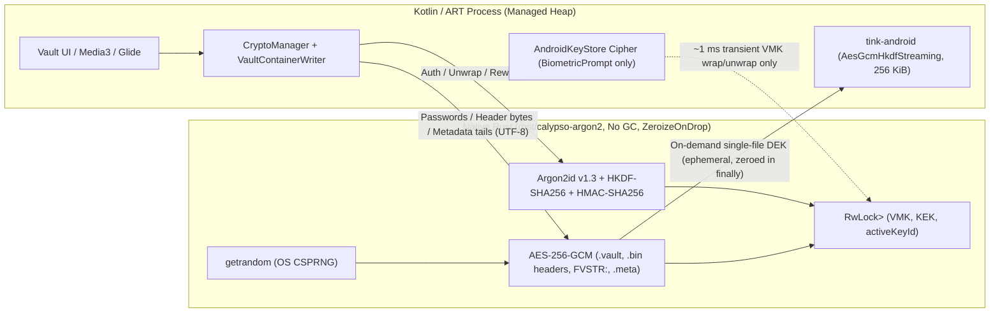

# ADR 0010: Rust-Native Vault Session and Master Key Isolation (`RustCrypto` + `Tink` Boundary)

- **Status:** Implemented
- **Date:** 2026-11-28
- **Goal:** Isolate the Vault Master Key (`VMK`), Key Encryption Key (`KEK`), and all single-block vault cryptographic operations inside garbage-collection-free native Rust memory (`rust/calypso-argon2`, `libcalypso_argon2.so`) with deterministic `zeroize` wiping, while keeping `FGVLTENC` v1 payload streaming on `tink-android` and preserving 100% backward compatibility with existing vaults, biometric enrollments, and `tools/calypso-cli/`.
- **Relates to:** [ADR 0001](0001-tink-streaming-aead-migration.md), [ADR 0002](0002-operational-security-hardening.md), [ADR 0004](0004-argon2-memory-and-cross-device-kdf.md), [ADR 0006](0006-strong-biometrics-only.en.md), [DOCS.md](../../DOCS.md)

---

## 1. Context and Threat Model

Prior to this change (even after ADR 0004 moved Argon2id derivation into native Rust), the unlocked vault session remained on the Android Runtime (ART) JVM heap inside `CryptoManager`:

1. **Long-lived `VMK` and `KEK` on the managed heap:** `unlockedMasterKey` (`VMK`) and `unlockedKek` (`KEK`) were stored as Kotlin `ByteArray`s for the entire duration of an unlocked session. Although `CryptoManager.clearKeys()` overwrote those arrays with zeros on lock, ART uses a **moving/compacting garbage collector** that can relocate arrays during GC cycles and leave stale plaintext copies in reclaimed or previously compacted heap regions. Furthermore, every JCA `SecretKeySpec(key, "AES")` construction clones the raw key bytes internally inside Java crypto providers.
2. **Per-file DEK accumulation in `metadataCache`:** `EncryptedFileMetadata` previously carried `fileKey: ByteArray` (the 32-byte per-file DEK), and `CryptoManager.metadataCache` cached `EncryptedFileMetadata` for every browsed `.bin` file across the session. Reading a directory of encrypted media therefore populated dozens or hundreds of DEKs on the managed heap.
3. **Why not move payload streaming to Rust as well?** `FGVLTENC` v1 payloads use Tink's `AES256_GCM_HKDF` random-access streaming (`TinkStreamSpec` — 256 KiB segments, seekable `FileChannel` adapter for Media3 ExoPlayer and Glide). Re-implementing Tink's streaming AEAD state machine and segment-seeking logic in Rust would duplicate a battle-tested primitive, risk framing/nonce bugs, and forfeit upstream `tink-android` security updates via Gradle.

By contrast, `.vault` unwrapping/wrapping, `FGVLTENC` v1 header encryption/decryption, `FVSTR:` metadata records, `.meta` folder names, and `CliBridgeManager` KEK fingerprinting are all **single-block operations** with no streaming state machine. Moving the master key session and those single-block operations into pure-Rust **RustCrypto** crates achieves deterministic `zeroize` cleanup without sacrificing Tink streaming stability.

---

## 2. Architectural Split (Rust Session vs. Tink Streaming)

### Responsibilities Across the JNI Boundary

| Responsibility | Execution Layer | Key Material Exposure |
| :--- | :--- | :--- |
| **Session state (`VMK`, `KEK`, `activeKeyId`)** | **Rust** (`RwLock<Option<VaultSession>>` with `#[derive(Zeroize, ZeroizeOnDrop)]`) | Never exported to JVM during normal password/PIN/pattern sessions. |
| **Argon2id KDF & `.vault` wrap/unwrap/verify/rewrap** | **Rust** (`argon2 0.6` + `aes-gcm 0.11`) | Password UTF-8 bytes are zeroed in Kotlin `finally` and Rust `Zeroizing<Vec<u8>>`; PDK never leaves Rust. |
| **`FGVLTENC` v1 header encrypt/decrypt/rename** | **Rust** (`hkdf 0.13` + `sha2 0.11` + `aes-gcm 0.11`) | `headerKey` never leaves Rust; `decryptFileHeaderMetadataNative` strips and zeroes the DEK inside Rust; `reencryptFileHeaderNative` renames containers without returning the DEK to Kotlin. |
| **On-demand single-file DEK** | **Rust → ephemeral JVM buffer → Tink** | Kotlin requests the 32-byte DEK via `unwrapFileDekNative` (or receives it in `Prepared` during encryption) only when constructing `TinkStreamSpec.streamingAead(dek, ...)`, and zeroes the JVM `ByteArray` immediately in `finally`. |
| **Payload streaming (`AES256_GCM_HKDF`)** | **Kotlin / `tink-android`** (`TinkStreamSpec`) | Uses the single-file DEK only; Tink updates are received via Gradle. |
| **`FVSTR:` encrypted strings** | **Rust** (`hkdf 0.13` + `aes-gcm 0.11`) | Preserves the exact legacy double-prefixed HKDF `info` (`"CalypsoGallery:Metadata:AESGCM\|CalypsoGallery:Metadata:AESGCM\|<purpose>"`) and single-prefixed AAD (`"CalypsoGallery:Metadata:AESGCM\|<purpose>"`) documented in [DOCS.md](../../DOCS.md#22-container-format-contract-helpersvault). |
| **`.meta` folder names (`FGMETA`)** | **Rust** (`aes-gcm 0.11` with session `VMK`) | `VMK` stays in Rust; only plaintext/ciphertext folder names cross JNI. |
| **CLI Bridge KEK fingerprint** | **Rust** (`hmac 0.13` + `sha2 0.11`) | Computes `HMAC-SHA256(KEK, "calypso-cli-bridge")[0..8]` inside Rust; `KEK` never leaves Rust. |

---

## 3. Zero-JVM-Exposure Boundary and the Biometric (`AndroidKeyStore`) Nuance

### 3.1 Password / PIN / Pattern Flows
For all non-biometric credential flows—creating a vault, unlocking with password/PIN/pattern, verifying the current secret (`isCurrentVaultSecret`), and re-wrapping `.vault` under recalibrated KDF parameters (`rewrapVaultHeaderWithCurrentKdf`)—**neither `VMK`, `KEK`, nor `PDK` ever enters JVM memory**.
- Password `CharArray` inputs are encoded into a transient UTF-8 `ByteArray` in Kotlin, passed over JNI, copied into `Zeroizing<Vec<u8>>` in Rust, and wiped in `finally` on the Kotlin side immediately upon return.
- Ephemeral verification and KDF re-wrapping unwrap keys into local `Zeroizing` structs inside Rust and drop them before returning, without touching the global `VaultSession`.

### 3.2 Biometric (`AndroidKeyStore`) Exception and Compatibility Trade-Off
Under [ADR 0006](0006-strong-biometrics-only.en.md), biometric unlock binds the vault to an `AndroidKeyStore` AES-256-GCM key (`BIOMETRIC_KEYSTORE_ALIAS`, StrongBox/TEE hardware-backed, `AUTH_BIOMETRIC_STRONG`) unlocked by `BiometricPrompt.CryptoObject`. Because Android's `AndroidKeyStore` hardware key material cannot be exported and can only be driven through Java's `javax.crypto.Cipher` authenticated by `BiometricPrompt`:

- **Enrollment (`completeBiometricSetup`):** Kotlin requests a short-lived copy of `VMK` from Rust (`exportVmkForBiometricWrapNative`), encrypts it with the authenticated Keystore `Cipher`, stores `iv || ciphertext` in `vaultBiometricWrappedBundle`, and immediately wipes the transient `ByteArray` in `finally` (`masterKey.fill(0)`).
- **Unlock (`completeBiometricUnlock`):** Kotlin decrypts `vaultBiometricWrappedBundle` with the authenticated Keystore `Cipher` into a transient `bundle` `ByteArray`, passes `vmk` alongside the `.vault` header bytes to `unlockVaultWithVmkNative` (which unwraps `KEK` from `.vault` inside Rust and populates `VaultSession`), and immediately wipes `encrypted`, `bundle`, and `vmk` in `finally`.

**Security impact:** While the transient ~1 ms JVM buffer during biometric setup/unlock cannot be eliminated without abandoning `AndroidKeyStore` hardware binding, **neither `VMK` nor `KEK` persists on the ART heap across the unlocked session**, and existing user biometric enrollments remain 100% compatible with zero re-enrollment required.

---

## 4. Elimination of `metadataCache` DEK Caching and Zero-DEK Rename

1. **Compile-time removal of `EncryptedFileMetadata.fileKey`:** `EncryptedFileMetadata` no longer has a `fileKey` property. `decryptFileHeaderMetadataNative` verifies the `FGVLTENC` v1 header GCM tag in Rust, extracts non-secret metadata (`algorithmParams`, `segmentSize`, `ciphertextLength`, `originalName`, timestamps, dimensions, thumbnail), and **discards/zeroes the 32-byte DEK inside Rust**. `CryptoManager.metadataCache` therefore holds zero cryptographic key material.
2. **On-demand single-file DEK unwrap:** `openDecryptedContentStream` and `verifyFileIntegrity` call `unwrapFileDekNative` to obtain only the single file's 32-byte DEK into a local JVM `ByteArray`, pass it to `TinkStreamSpec.streamingAead(dek, segmentSize)`, and immediately zero the local `ByteArray` in `finally`.
3. **Zero-DEK container rename:** Previously, `renameEncryptedFile` read `meta.fileKey` into Kotlin and passed `(kek, dek)` to `VaultContainerWriter.rewriteContainer`. Now `VaultContainerWriter.rewriteContainer` delegates header decryption and re-encryption to `reencryptFileHeaderNative`, which unwraps the old header, preserves `(segmentSize, ciphertextLength, dek)` inside Rust, re-encrypts the header with a fresh IV and the new filename/metadata tail, and never exposes the DEK to Kotlin.

---

## 5. Crate Selection and F-Droid / Reproducible Build Compliance

All new primitives use pure-Rust **RustCrypto** crates aligned with the existing `argon2 = "0.6.0"` (`digest 0.11`, `hybrid-array 0.4`) dependency tree in [rust/calypso-argon2/Cargo.toml](../../rust/calypso-argon2/Cargo.toml):

| Crate | Version Line | Purpose |
| :--- | :--- | :--- |
| `argon2` | `0.6.0` (`alloc`, `zeroize`) | RFC 9106 Argon2id v1.3 KDF |
| `aes-gcm` | `0.11` (`aes`, `alloc`, `zeroize`) | Constant-time AES-256-GCM (ARMv8 crypto / AES-NI accelerated, wipes expanded round keys on `Drop`) |
| `hkdf` | `0.13` | RFC 5869 HKDF-SHA256 (`CalypsoGallery:Header:AES256GCM` & `CalypsoGallery:Metadata:AESGCM`) |
| `hmac` | `0.13` | HMAC-SHA256 for CLI bridge KEK fingerprinting |
| `sha2` | `0.11` | SHA-256 digest backend for HKDF and HMAC |
| `zeroize` | `1.8.1` (`derive`) | `Zeroizing<T>` and `#[derive(Zeroize, ZeroizeOnDrop)]` volatile memory wiping |
| `getrandom` | `0.2.17` | Unseeded OS CSPRNG (`getrandom(2)` / `/dev/urandom` on Android; `bcrypt` without `raw-dylib`/`dlltool` on Windows GNU) |
| `jni-sys` | `0.4.1` | Zero-dependency Android & desktop host-test JNI bindings (matching `rust/calypso-media`) |

### Why Not `ring` or `aws-lc-rs`?
- Both `ring` and `aws-lc-rs` rely on C/assembly build scripts (and Perl/CMake/NASM on some targets), which add fragile cross-compilation complexity across all 4 Android NDK ABIs (`arm64-v8a`, `armeabi-v7a`, `x86`, `x86_64`), desktop JVM host tests, and **F-Droid offline `--locked` reproducible builds**.
- Neither provides Argon2id, so RustCrypto would remain in the tree regardless. Using pure-Rust RustCrypto keeps one cohesive dependency graph, produces small `.so` binaries, and works offline with committed `Cargo.lock`.
- The existing crate path (`rust/calypso-argon2`) and shared library name (`libcalypso_argon2.so`) are retained to avoid churn across Gradle NDK tasks, CI workflows, `cargo audit`, and Dependabot.

---

## 6. Known Limitations and Honest Security Boundaries

1. **Compiler / Hardware Limits on `zeroize`:** `zeroize` guarantees volatile writes + compiler fences on heap allocations before freeing, preventing dead-store elimination. However, no user-space library in any language can guarantee erasure of CPU registers, compiler stack spills, or OS swap/hibernation pages.
2. **Tink's Internal Single-File `ikm` Copy:** `com.google.crypto.tink.subtle.AesGcmHkdfStreaming` copies the `dek` slice passed to its constructor into an internal `byte[] ikm` field for the lifetime of that `StreamingAead` / `SeekableByteChannel` instance. While that single file is being decrypted or encrypted, its single-file DEK exists inside Tink's object; all other files' DEKs and the vault's `VMK`/`KEK` do not.
3. **Biometric Transient Buffer:** As detailed in §3.2, `VMK` briefly traverses a zeroized JVM `ByteArray` (~1 ms) during `AndroidKeyStore` cipher operations in `CryptoManagerBiometrics`.
4. **Lock Synchronization During Active File Operations:** `CryptoManager.clearKeys()` continues to respect `activeCryptoOperations` / `pendingLock` (registered via `ForegroundOperationRegistry`) so in-flight batch encryption/export completes cleanly before `lockSessionNative()` wipes the Rust session.

---

## 7. Backward Compatibility Matrix and Verification

| Component | Compatibility | Notes |
| :--- | :--- | :--- |
| **`.vault` v1 Header** | **100% compatible** | Exact byte layout (`FGVLT` \| `version=1` \| `kdf=1` \| `iter` \| `mem` \| `par` \| `prot` \| `salt` \| `ivPdk` \| `wrappedVmK` \| `ivVmk` \| `wrappedKeyring`). |
| **`FGVLTENC` v1 `.bin` Files** | **100% compatible** | Tested against desktop CLI golden fixtures (`CliFixtureCompatibilityTest`) and `VaultContainerReadTest` / `VaultContainerWriterTest`. |
| **`FVSTR:` Encrypted Records** | **100% compatible** | Preserves double-prefixed HKDF `info` and single-prefixed AAD for album names, stealth `JSON/`, and operation resume manifests. |
| **`.meta` (`FGMETA`) Folders** | **100% compatible** | AES-256-GCM with session `VMK` and empty AAD. |
| **Biometric Enrollments** | **100% compatible** | Existing `vaultBiometricWrappedBundle` records unlock without re-enrollment. |
| **CLI Bridge (`CliBridgeManager`)** | **100% compatible** | Identical 8-byte `HMAC-SHA256(KEK, "calypso-cli-bridge")` fingerprint. |

**Verification:**
- `cargo test --manifest-path rust/calypso-argon2/Cargo.toml --locked` (primitives, golden vectors, session lifecycle, tamper/auth rejection)
- `./gradlew :app:testFossDebugUnitTest` (JVM tests including `CliFixtureCompatibilityTest`, `NativeArgon2CompatibilityTest`, `VaultLockPolicyTest`, and `RustVaultSessionPolicyTest`)
- `./gradlew :app:buildRustArgon2Android` (cross-compilation across all 4 Android ABIs with `--locked`)
- `./gradlew :app:detektFossDebug :app:lintFossDebug` (`maxIssues: 0`)
